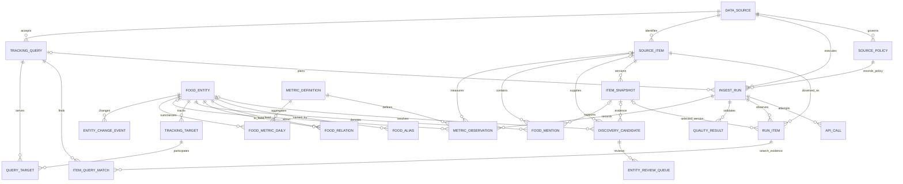

# Oracle 목표 데이터 모델 설계안

2026-10-26. **논리·물리 설계 제안이며 실행 DDL이 아니다. Oracle 생성·설치·연결·이관은 수행하지 않았다.** 현재 상태와 근거는 [통합 감사](REPORT.md), 단계 계약은 [탐지·추적 설계](TRACKING_DESIGN.md)를 참조한다.

## 설계 선택과 적용 범위

요청된 12개 후보 테이블은 모두 유지하되 역할을 명확히 분리한다. `FOOD_ALIAS`가 EXACT_ALIAS를, `FOOD_RELATION`이 서로 다른 음식의 VARIANT_OF/RELATED_TO를 표현한다. 출처 콘텐츠와 검색 결과, 음식 언급, 수치 관측은 별개다. DataLab은 콘텐츠 레코드를 억지로 생성하지 않는다.

보조 테이블을 추가하는 이유는 다음과 같다. 원본의 버전과 회차 관계를 위해 ITEM_SNAPSHOT/RUN_ITEM, 검색 근거를 위해 ITEM_QUERY_MATCH/QUERY_TARGET, 승인 전 후보와 품질을 위해 DISCOVERY_CANDIDATE/QUALITY_RESULT, 정책을 위해 SOURCE_POLICY, 개체 변경 복원을 위해 ENTITY_CHANGE_EVENT, 운영 실행을 위해 API_CALL/OUTBOX_EVENT/QUOTA_BUCKET/WORK_LEASE가 필요하다. METRIC_DEFINITION은 단위와 집계 규칙을 코드마다 중복 정의하지 않게 한다. LEGACY_KEY_MAP은 이관 도구용으로만 사용한다. 모든 테이블을 첫 릴리스에 만들 필요는 없고 [로드맵](ROADMAP.md) 순서로 적용한다.

## 공통 자료형·제약 규칙

아래 약어는 설계 표의 정확한 자료형을 뜻한다.

| 약어 | Oracle 물리형·의미 |
| --- | --- |
| ID | NUMBER(19,0), generated identity 또는 sequence. 내부 PK. ID는 양수, 외부 식별자는 이 형으로 변환하지 않음 |
| KEY | VARCHAR2(256 CHAR): 출처 외부 ID·키. 길이 초과 URL은 원문 CLOB과 별도 SHA256키로 분리 |
| NAME | VARCHAR2(200 CHAR): 표시명/정규화명. byte 수와 한글 길이를 혼동하지 않음 |
| CODE | VARCHAR2(40 CHAR): 상태·유형·버전 코드. 필수 enum은 NOT NULL+CHECK 또는 코드 FK |
| TS | TIMESTAMP(6) WITH TIME ZONE: 순간 시각. 입력 timezone 필수, UTC로 저장·전달 |
| DAY | DATE: Asia/Seoul의 날짜, 시간부분은0. CHECK(day_col=TRUNC(day_col)); Python date로 바인딩 |
| J | 기본 호환안 CLOB CHECK(column IS JSON). nullable 여부는 별도. 실제26ai에서는 native JSON 선택 가능 |
| TXT/BIN/H | CLOB / BLOB / RAW(32) SHA256. 원문에 대한 UNIQUE 비교는 LOB가 아니라 H와 식별키로 수행 |
| FLAG | NUMBER(1,0) NOT NULL CHECK(value IN (0,1)). 19c 호환을 위해 SQL BOOLEAN에 의존하지 않음 |
| COUNT | NUMBER(38,0) CHECK(value>=0). 실제 값 미제공은 NULL. 숫자문자열도 정확한 정수로 이관 |
| DEC | NUMBER(20,8). 비율·원시지수용. 통계 추정값의 precision/scale은 실제자료 검증 후 조정 |

PK와 표의 UNIQUE는 B-tree 인덱스를 만든다는 전제로 중복 인덱스를 추가하지 않는다. FK는 Oracle이 자동으로 인덱싱한다고 가정하지 않으며 **모든 자식 FK의 선두컬럼 인덱스**를 별도로 보장한다. 아래 `추가 인덱스`는 이 기본 규칙 외의 조회용 인덱스다. 모든 상태 이력에는 created_at TS·updated_at TS 또는 불변 recorded_at TS를 둔다. `valid_to IS NULL OR valid_to>valid_from`, 시작/완료 순서 등 가능한 로컬 조건은 CHECK로 강제한다. 복수 테이블의 출처 일치·허용 정책·정규화 충돌·관계 순환은 서비스 트랜잭션 검증이 담당한다.

Oracle은 VARCHAR2의 빈 문자열을 NULL로 처리하므로 캡션 missing/empty/no_tags/parsed/purged 상태를 별도 보존한다. 원문이 필요한 빈 CLOB은 드라이버 바인딩과 JSON 내부 문자열로 구분한다. [Oracle JSON·CLOB](https://docs.oracle.com/en/database/oracle/oracle-database/19/adjsn/json-in-oracle-database.html), [빈 문자열과 JSON 변환](https://docs.oracle.com/en/database/oracle/oracle-database/19/adjsn/json-developers-guide.pdf).

## 논리 ERD

운영 잠금·이관 테이블은 ERD에서 생략하고 아래 명세에서 정의한다. 관계선의 optionality는 과거 미기록과 만료 삭제를 허용하기 위한 것이다.

## 테이블별 물리 명세

보존 기호: **C**=사람/앱이 생성한 설정·결정, 서비스 운영에 필요한 동안 유지하되 삭제 요청·접근통제 적용. **O**=비밀값 없는 운영 메타데이터, 초기90일 검토 주기를 제안하나 공급자 제한이 더 짧으면 우선. **S**=출처·필드별 승인된 TTL, 허용 미확인 시 신규 영구보존 비활성. **D**=파생물로서 원출처 허용 범위·원본만료·삭제 요청 전파. 90일 등은 공식 의무기간이 아닌 운영 제안이다. 이관은 기존 데이터의 보관권한을 새로 만들어주지 않는다.

| 테이블·역할 | PK/FK 및 핵심 컬럼 | UNIQUE·CHECK·추가 인덱스 | 보존·기존 매핑 |
| --- | --- | --- | --- |
| DATA_SOURCE: 출처와 의미 식별 | source_id ID PK, code CODE, base_endpoint VARCHAR2(512 CHAR), enabled FLAG, default_timezone VARCHAR2(64 CHAR), schema_version CODE | U(code). 토큰/키 저장 금지. code는 google_trends_rss/instagram_graph/youtube/naver_datalab | C. 기존 상수·출처문자열을 명시적 행으로 등록 |
| SOURCE_POLICY: 버전된 권한·TTL | policy_id ID PK, source_id FK, version CODE, raw_allowed FLAG, derived_allowed FLAG, raw_ttl_days NUMBER(5), derived_ttl_days NUMBER(5), permission_state CODE, evidence_url TXT, effective_from/to TS | U(source_id,version); state VERIFIED/UNKNOWN/BLOCKED, TTL>0 또는NULL. UNKNOWN에서 allowed=0. I(source_id,effective_from) | C. 기존 NAVER 미저장, YT29일·분석off, IG캡션30일을 **현행운영값**으로 매핑. 공식 허가와구분 |
| INGEST_RUN: 논리작업·커버리지 | run_id ID PK, source_id FK, query_id FK nullable, policy_id FK, job_key H, origin CODE, trigger CODE, status CODE, started_at/finished_at TS, actual_request J, context_hash H, window_start/end TS nullable, returned_count/accepted_count COUNT, coverage CODE, error_kind CODE, legacy_flag FLAG | U(job_key). origin live_api/mock/legacy_unknown; status PLANNED/RUNNING/SUCCESS/PARTIAL/LIMITED/FAILED/INTERRUPTED/NO_REQUEST. 완료>=시작, 반환>=채택. I(source_id,started_at), I(status,started_at) | O+S: actual_request의민감필드·API토큰 금지. runs/instagram_runs/youtube_runs 매핑, naver는시도별legacy논리run으로만이관하고임의배치합치지않음 |
| API_CALL: 실제시도·할당량 | call_id ID PK, run_id FK, attempt_no NUMBER(6), endpoint CODE, quota_scope KEY, budget_day VARCHAR2(10 CHAR), status CODE, http_status NUMBER(3), started/finished TS, charged_estimate DEC | U(run_id,attempt_no); HTTP100~599 또는NULL, 번호>0. I(quota_scope,budget_day,endpoint). request본문·response원문없음 | O. naver_calls/youtube_calls. IG는회차집계만있어가상의개별시도를생성하지 않음 |
| SOURCE_ITEM: 콘텐츠 식별·현재상태 | item_id ID PK, source_id FK, external_key KEY, key_kind CODE, published_at TS nullable, first_seen/last_seen TS, availability CODE, legacy_origin CODE | U(source_id,external_key), first<=last. I(source_id,last_seen), I(published_at). 원문 payload를이식별행에고정하지않음 | S. RSS items.source_id해시, IG media.id, YTvideo_id. NAVER는해당없음 |
| ITEM_SNAPSHOT: 허용된원본과정규화버전 | snapshot_id ID PK, item_id FK, payload_hash H, adapter_version CODE, normalized_payload J nullable, raw_payload BIN nullable, field_states J, captured_at/refreshed_at/expires_at/purged_at TS, evidence_kind CODE | U(item_id,payload_hash,adapter_version). 캡션같은필드별expires는field_states에기록하고원문과파생의짧은기한우선. I(expires_at), I(item_id,captured_at) | S. RSS observations.payload·runs원본참조, IG확보캡션·태그증거, YT현재영상. YT과거원문은없음. DataLab응답금지 |
| RUN_ITEM: 회차↔콘텐츠 | run_id FK, item_id FK 복합 PK, snapshot_id FK nullable, observed_at TS, returned_multiplicity COUNT, evidence_kind CODE, quality_status CODE | multiplicity>=1, I(item_id,observed_at). snapshot.item_id 일치검증 | S/O. RSS observations, IG analysis_observations의run연결. legacy IG는run_id가없으므로legacy논리run과원시last_seen근거를명시, 실제 API회차로위장금지 |
| ITEM_QUERY_MATCH: 검색 일치 증거 | match_id ID PK, run_id/item_id 복합 FK→RUN_ITEM, query_id FK, matched_at TS, verification CODE, expires_at TS | U(run_id,item_id,query_id). verification SEARCH_ONLY/CONTENT_CONFIRMED 중초기는SEARCH_ONLY. I(query_id,matched_at), I(expires_at) | S. youtube_matches·instagram_hashtag_media를기반으로이관하되회차미기록은legacy로표현. 식품언급을자동생성하지 않음 |
| DISCOVERY_CANDIDATE: 승인전후보 | candidate_id ID PK, item_id FK nullable, snapshot_id FK nullable, surface_text NAME, normalized_text NAME, scope_key KEY, classification CODE, entity_type CODE, rule_version CODE, rule_score NUMBER(3), evidence J, status CODE, resolved_food_id FK nullable, idempotency_key H | U(idempotency_key); classification FOOD/REVIEW/NON_FOOD, score0~100, status NEW/NEEDS_REVIEW/APPROVED/REJECTED/RESOLVED. I(status,created_at), I(normalized_text) | C+S. candidates와classification_history를현재/이벤트로분리. 사용자 음식은item_id NULL 허용. 후보ID와item_id는독립 |
| QUALITY_RESULT: 검증 내역 | result_id ID PK, run_id FK, item_id FK nullable, snapshot_id FK nullable, rule_code/version CODE, severity CODE, outcome CODE, details J, checked_at TS, event_key H | U(event_key); outcome PASS/WARN/FAIL/NOT_APPLICABLE. I(run_id,outcome), I(item_id,checked_at). details에 원문·키 복사 금지 | O/S. 현재 warnings·필드 결측을 매핑. 과거 세부 기록이 없으면 당시 검사 결과를 만들어내지 않음 |
| FOOD_ENTITY: 공통 음식 | food_id ID PK, canonical_name NAME, entity_kind CODE, status CODE, revision NUMBER(10), created_at TS, retired_at TS nullable | kind DISH/PRODUCT/INGREDIENT/FOOD_CONCEPT; status ACTIVE/RETIRED/MERGED. 대표명UNIQUE금지(동형어가능). I(canonical_name,status). 브랜드/매장등록금지 | C. youtube_foods는검토 후매핑, 현재0. RSS FOOD도자동생성하지않고승인 |
| FOOD_ALIAS: EXACT_ALIAS | alias_id ID PK, food_id FK, surface_form NAME, normalized_form NAME, scope_key KEY NOT NULL, relation_kind CODE='EXACT_ALIAS', norm_version CODE, status CODE, valid_from/to TS, approved_event_id FK→ENTITY_CHANGE_EVENT nullable | CHECK kind=EXACT_ALIAS. 활성 별칭에 function-based U(CASE WHEN status='ACTIVE' THEN normalized_form END, CASE WHEN status='ACTIVE' THEN scope_key END). I(food_id,status). 기간중복·다의어를승인 트랜잭션검증 | C+S. ALIASES dict의수동확정3표기를검토이관. 공동태그와검색 문자열을무조건별칭으로이관하지않음 |
| FOOD_RELATION: 서로다른음식관계 | relation_id ID PK, from_food_id/to_food_id FK, relation_type CODE, valid_from/to TS, evidence J, status CODE | from!=to, type VARIANT_OF/RELATED_TO. 활성 directed pair+type에조건부U. RELATED_TO는ID작은쪽→큰쪽으로정렬CHECK, VARIANT_OF순환은서비스검사. I(to_food_id,type) | C+S. 현재없음. 유사문자열·공동출현만으로관계확정금지 |
| FOOD_MENTION: 콘텐츠의 실제 음식 언급 | mention_id ID PK, item_id FK, snapshot_id FK nullable, food_id FK, candidate_id FK nullable, field_code CODE, span_start/end NUMBER(10), evidence_text NAME nullable, resolver_version CODE, decision_event_id FK nullable, status CODE, expires_at TS, mention_key H NOT NULL | U(mention_key): item/snapshot/food/field/span/resolver version의 정규화 키. 미기록 snapshot/span은 별도 명시 토큰으로 직렬화. span은 0<=start<end 또는 모두 NULL. I(food_id,item_id), I(expires_at) | S/D. 현재 공통 모델 없음. IG 태그는 검토 후 허용 범위에서만, YT 검색 일치만으로 생성 금지 |
| TRACKING_TARGET: 음식 추적 의사 | target_id ID PK, food_id/source_id FK, account_scope KEY, status CODE, generation NUMBER(10), interval_seconds NUMBER(10), next_due_at TS, last_success_at TS nullable, origin CODE, approved_event_id FK nullable | U(food_id,source_id,account_scope); status PENDING/ACTIVE/PAUSED/STOPPED/BLOCKED, interval>0. I(status,next_due_at). 한 음식·출처의 여러 검색어는 query로 분리 | C. IG 활성/승인 태그, NAVER 대상, YT tracking을 검토 후 이관. 사용자/자동을 origin으로 구분하고 실행 경로 공유 |
| TRACKING_QUERY: 불변검색계획버전 | query_id ID PK, source_id FK, account_scope KEY, spec_hash H, query_kind CODE, query_text TXT nullable, params J, planner_version CODE, policy_id FK, mode CODE, created_at TS | U(source_id,account_scope,spec_hash); mode DISCOVERY/TRACKING. 이름변경으로과거params갱신금지. I(source_id,mode) | C+S. youtube_queries, IGtag이름/ID, NAVER요청그룹을버전별계획으로매핑. APIpage_token은단기운영자료로별도만료 |
| QUERY_TARGET: 계획↔타깃 M:N | query_id FK, target_id FK, group_key KEY, alias_id FK nullable; PK(query_id,target_id,group_key) | I(target_id,query_id). source 일치·Naver각group의food충돌을검증. 여러음식의모호한별칭을같은group에넣지않음 | C/S. candidate↔tag/food, Naver topic단위그룹에대응. 기존후보ID를food_id로대체하는직접캐스트금지 |
| METRIC_DEFINITION: 단위·합산규칙 | metric_id ID PK, code CODE, unit CODE, subject_kind CODE, aggregation CODE, derived FLAG, policy_class CODE | U(code); aggregation DISTINCT_ITEM/SNAPSHOT/RATIO/PROVIDER_BUCKET. 비교불가unit혼합금지 | C. 현재source별고정의미를코드화. 유행점수코드·가중치미정 |
| METRIC_OBSERVATION: 원시수치관측 | observation_id ID PK, run_id/source_id/query_id/metric_id FK, food_id/item_id FK nullable, context_hash H, subject_key KEY NOT NULL, observed_at TS, period_start/end TS nullable, count_value COUNT nullable, decimal_value DEC nullable, raw_value TXT nullable, time_basis CODE, quality CODE, origin CODE, expires_at TS nullable, observation_key H | U(observation_key): run+subject+metric+provider_period. 값의존재형식과metric정의일치검증, period_end>start. I(food_id,metric_id,observed_at), I(item_id,metric_id,observed_at), I(expires_at). NAVERratio CHECK0~100은metric별검증 | S. IG신규관측근거/RSStraffic/YT현재stats. NAVER저장비활성, YTstats이력비활성. 스냅샷갱신이과거 값보존허가가아님 |
| FOOD_METRIC_DAILY: 재생성 가능한 일별 지표 | food_id/source_id/metric_id FK, metric_day DAY, context_hash H, aggregation_version CODE, origin CODE 복합 PK; count_value COUNT nullable, decimal_value DEC nullable, unique_items COUNT nullable, expected_runs/completed_runs COUNT, coverage CODE, lineage J, expires_at TS nullable | I(source_id,metric_day,metric_id). 초기에는 live만 허용하고 다른 origin은 별도 실험으로 격리. coverage MISSING/FAILED/PARTIAL/OBSERVED, NULL과 0 구분. 지표 정의에 맞는 값 형식만 채택. 다른 context를 합치지 않음 | D. IG metrics는 태그 단위 관측으로 먼저 이관하고 승인 food 매핑 후만 생성. NAVER/YT 파생행은 허가 전 생성 금지 |
| ENTITY_REVIEW_QUEUE: 사람결정대기 | review_id ID PK, candidate_id FK, proposed_food_id FK nullable, status CODE, reason CODE, evidence J, version NUMBER(10), decision_event_id FK nullable | 활성candidate당조건부U, status OPEN/CLAIMED/APPROVED/REJECTED/DEFERRED. I(status,created_at). 낙관잠금version검증 | C+S. 현재 DB에없음. 기존분류history를사람 승인으로변환금지 |
| ENTITY_CHANGE_EVENT: 별칭·관계·병합/분리이력 | event_id ID PK, food_id FK, event_type CODE, occurred_at TS, actor_type CODE, actor_ref KEY nullable, previous_state/next_state J, affected_keys J, reverses_event_id selfFK nullable, event_key H | U(event_key), type CREATE/ALIAS_CHANGE/RELATION_CHANGE/MERGE/SPLIT/REVERSE. I(food_id,occurred_at). actor는개인정보최소화한내부참조 | C+S. classification_history는별도candidate판정증거로매핑, 과거개체결정이없으면빈상태 |
| OUTBOX_EVENT: 재시도가능한내부전달 | event_id ID PK, aggregate_type CODE, aggregate_id KEY, event_type CODE, dedupe_key H, payload J, state CODE, available_at TS, attempts COUNT | U(dedupe_key), state READY/CLAIMED/DONE/DEAD. I(state,available_at). payload에API키·만료원문금지 | O/S. 신규. ENTITY_RESOLVED/TARGET_CHANGED/INGEST_COMMITTED/INVALIDATE_AGGREGATE 전달 |
| QUOTA_BUCKET: 원자적예산예약 | source_id FK, account_scope KEY, bucket_code CODE, window_key KEY 복합 PK, limit_value/used_value COUNT, reset_at TS, provider_basis CODE | used>=0, limit>0. 예약시행잠금+한도검증, 실패도보수적소비로취급. quota단위와API원격실측을구분 | O. naver_calls/youtube_calls/instagram_searches의집계를기초로복원. IGrolling7일은고유tag별기록도필요하므로해당예약은API_CALL메타와함께판정 |
| WORK_LEASE: 작업소유·중복차단 | resource_key KEY PK, owner_key KEY, generation NUMBER(19), expires_at TS, renewed_at TS | I(expires_at), generation증가. owner+generation가맞을때만결과commit. HTTP중DBrowlock유지금지 | O. instagram_leases/youtube_state lease/naver_guards. 오래된잠금은이관활성화하지 않음 |
| LEGACY_KEY_MAP: 이관 대조 | batch_key KEY, legacy_table CODE, legacy_key KEY, target_table CODE 복합 PK; target_key KEY, source_hash H, imported_at TS | I(target_table,target_key). 원본 한 행을 같은 목적 테이블의 여러 행으로 분해하면 legacy_key에 subkey를 포함. 음식 식별과 구분 | O. 원본 PK를 보존해 재실행 시 중복 이관 방지. 대조·rollback 기간 종료 후 메타 보존 검토 |

SOURCE_POLICY의 유효 기간 중복은 승인 트랜잭션에서 차단한다. 후보 두 개를 동시에 같은 별칭으로 승인할 경우 활성 별칭 UNIQUE를 마지막 방어선으로 사용하고, 패한 트랜잭션의 새 음식 생성을 rollback한 뒤 기존 food_id를 다시 조회한다. 동형어를 같은 scope에서 강제 연결하지 않고 문맥을 구분할 수 있을 때만 scope를 세분화한다. 조건이 불충분하면 검토 상태를 유지한다. 표의 모든 제약은 실제 Oracle 버전에서 migration integration test를 통과한 뒤 배포한다.

## 원본·변환·정책 계보

콘텐츠별 첫 보관시각과 데이터 갱신시각을 구별한다. 동일한 RSS/IG payload를 재관측하면 RUN_ITEM만 늘고 내용 snapshot을 중복 생성하지 않는다. 출처가 허용하는 갱신은 refreshed_at과 정책상 유효 기간에만 반영한다. IG 동일캡션이 재수집됐다고 원문 보존 기한을 연장하지 않는다. YouTube 영상 메타데이터 갱신과 검색 관계 갱신의 만료는 독립이다.

SOURCE_ITEM 식별자가 같아도 adapter_version이 달라지면 새 정규화 snapshot을 만들 수 있다. parser_version·normalizer_version·classifier_version·resolver_version·aggregation_version을 계보에 남긴다. 원본이 삭제되면 raw_state=PURGED와 삭제사유만 남기고, 보존이 허용되지 않는 파생 태그·임베딩·일 집계·내보내기·백업·outbox payload까지 함께 만료한다. 원문이 없으면 이전 extractor를 다시 실행할 수 없다는 상태를 기록한다. 보존허가를 알 수 없는 경우에는 신규 결과의 raw·derived 적재를 기본 차단한다.

정책상 허용 전 NAVER `METRIC_OBSERVATION`은 **행 생성 자체를 하지 않는다**. INGEST_RUN·API_CALL에 요청 기간·그룹·필터·상태·출처를 남기고 응답은 화면요청 메모리에서만 사용한다. 검색 조건 메타데이터도 개인정보/민감검색어가 포함되는 서비스로 확장할 경우 별도 접근·보존 정책이 필요하다. 이번 MVP는 음식명 범위다.

YouTube는 SOURCE_ITEM·허용 snapshot·ITEM_QUERY_MATCH를29일 기한으로 이관할 수 있으나, 원래 collected/refreshed/matched 시각에서 계산한 **남은 기간**만 사용한다. 이관일을 새 확보일로 만들어 만료를 연장하지 않는다. 영상 statistics는 현재 snapshot 내용으로만 유지하고 승인 없는 historical metric 행·FOOD_MENTION·FOOD_METRIC_DAILY를 생성하지 않는다. legacy_origin은 legacy_unknown을 유지한다.

## 요청 조건과 지표 의미

`context_hash`는 원시값의 비교범위를 나타낸다. 출처·API버전·endpoint·account_scope·검색별칭집합·그룹구성·기간·timeUnit·필터·지역·언어·정렬·집계기준·정규화버전을 정규직렬화한다. 비밀키는 해시입력·DB저장에 넣지 않고 비밀값과 무관한 credential_scope 내부식별자를 쓴다. API_CALL의시도번호·cursor는 비교의미와별도로보존한다.

NAVER는 한 요청의 **모든 그룹 구성과 조회기간**이 비교단위다. 같은두쫀쿠라도7일/30일/90일·그룹조합·필터가다르면다른context다. 허가를받은뒤에만 provider period·ratio를보존하고, 독립요청을이어붙이거나절대검색량으로환산하지않는다. 주·월 ratio는공급자요청의timeUnit을따라별도관측이며일ratio평균/합계로만들지않는다.

IG 신규량은 게시일이 아닌 **태그/음식별 최초 관측일**이다. source별 고유 콘텐츠와 FOOD_MENTION을통해음식별distinct를계산하고, 태그별집계를단순합하지않는다. RSS traffic은원문하한표현을raw_value로보존하며정확한COUNT로간주하지않는다. YouTube 통계는영상별snapshot에서만표시한다. 영상viewCount는사람수·음식 언급량과다르다.

## 개체 병합·분리와 정정

대표명변경은food_id를바꾸지않는다. 병합은원래ID를삭제하지않고MERGED상태·redirect결정 이력을남긴다. 영향받은alias/mention/target의기존매핑과변경이벤트를저장하며정규원본은수정하지않는다. 잘못된합병분리는원래증거를기준으로각언급을다시배정하고모호한것은검토 큐로보낸다. 대상의별칭이변하면새query버전을생성하고이전run의query_id는유지한다. 관련집계를dirty로표시해재계산하고, 원문 만료로복구불가한관계는추정복원하지않는다.

## Oracle 실행·호환성 선택

| 항목 | 제안·확인 상태 |
| --- | --- |
| 개발DB | Oracle AI Database26ai Free 로컬VM/컨테이너 후보. 실제설치버전·Windows실행방식·가용메모리미확인. Free2코어/2GB/12GB 제한. 클라우드Always Free는계정·리전·현재조건확인 후별도선택 |
| 기존19c연계 | 기본CLOB/JSON check·NUMBER·TSTZ·identity/sequence 모델로대체가능. native JSON/VECTOR를초기필수로두지않음 |
| Python | 현재Python3.11/3.12, 표준sqlite3직접SQL. `python-oracledb` stable Thin+pool·:name바인드제안. 실제드라이버미설치이며연결미검증 |
| VECTOR | 승인된로컬음식명/별칭설명에대해후속도입가능. DB/driver지원조합확인 필수. 현재19c에VECTOR가있다고가정하지 않음. 최초exactalias/규칙에는불필요 |
| UPSERT | Oracle MERGE 또는 UPDATE후INSERT+UNIQUE충돌재조회. batch내key중복먼저정리. MERGE만으로동시 삽입경쟁이사라진다고가정하지않고ORA-00001재시도·행잠금을검증 |
| 트랜잭션 | API예약commit→HTTP→소유generation확인→검증·core저장·outbox동일commit. 긴HTTP중DB트랜잭션·rowlock을열어두지않음. 주기작업선점은FOR UPDATE SKIP LOCKED검토 |
| 마이그레이션 | 실행초기DDL제거, 버전이있는명시migration. Oracle DDL의implicit commit을고려해데이터적재 트랜잭션과분리. SQL/드라이버단위통합테스트필수 |
| 조회 | 음식·출처·metric·date별복합B-tree와latest snapshot인덱스. 작은규모는일반테이블+증분집계로시작. 파티션·압축·벡터인덱스는에디션·권한·비용검증후도입 |

공식 근거: [Oracle Free 제한](https://docs.oracle.com/en/database/oracle/oracle-database/26/xeinl/licensing-restrictions.html), [드라이버 Thin·Python 호환](https://python-oracledb.readthedocs.io/en/stable/user_guide/installation.html), [VECTOR 드라이버 지원](https://python-oracledb.readthedocs.io/en/latest/user_guide/vector_data_type.html), [MERGE 동작](https://docs.oracle.com/en/database/oracle/oracle-database/26/sqlrf/MERGE.html). VECTOR 문서의 latest는변경될수있으므로실제구현시stable드라이버와DB조합을고정한다. Free운영지원·패치특성은[Oracle FAQ](https://www.oracle.com/apac/database/free/faq/)를확인해야하며무료개발선택을운영지원계약으로간주하지않는다.

## 용량·운영 비용

현재 DB6.37MiB, RSS성공70응답의원본합계1,424,970bytes, 평균약20.36KB/회다. RSS를30분마다연속48회/일수집한다고가정하면원본만약0.98MB/일·0.357GB/년이다. 관측payload·이력·LOB오버헤드·인덱스·백업은별도여서이값을전체DB성장률로사용할수없다. 장기간정지구간이있는현재 DB로평균운영부하를산정하지않는다.

계획식은 `일반환콘텐츠×평균허용payload bytes×TTL일수 + 관측관계/메타 + 인덱스 + 백업`이다. 향후IG게시물/태그수와YouTube실제페이지수를실측해계수로넣는다. 신규배포후일별tablespace/LOB증가량·유효행수·만료 처리수·p95조회/적재지연을측정하고Free12GB한도의60/80%에서운영알림을제안한다. 데이터복제로Free제한이나공급자보존 기한을우회하지않는다. DB라이선스외에도호스트RAM/디스크/백업·운영인력·클라우드요금·공급자API요금이별도이며이번에가격을확정하지않는다.

## 이관 매핑·실행 순서·롤백

| 현재 | 목표·주의사항 |
| --- | --- |
| runs.raw_response / items / observations | INGEST_RUN / SOURCE_ITEM / ITEM_SNAPSHOT / RUN_ITEM. 같은item의다른관측은유지. source_id해시알고리즘·UTC값검증 |
| candidates / classification_history | DISCOVERY_CANDIDATE + 이전판정증거. item_id를food_id로쓰기금지. history의실제미기록classified_at은NULL유지 |
| instagram_hashtags / candidate_hashtags | query/target후보매핑. 태그와식품동일성승인 후만FOOD_ENTITY연결. 현재후보연결0 |
| instagram_media / hashtag_media | SOURCE_ITEM/허용snapshot/ITEM_QUERY_MATCH. 최초 관측과원게시 시각유지. 회차별원문없음 |
| instagram_analysis_observations / caption tags | RUN_ITEM·snapshot증거·정책 허용된추출태그. legacy67은실제과거회차로역산하지않음 |
| instagram_metrics | 출처태그단위기존집계로검증보관. 음식별집계로이관하려면개체승인·콘텐츠union·커버리지확인 필수 |
| naver_targets / calls / guards | target후보·INGEST_RUN/API_CALL·WORK_LEASE개념. 결과지수없음. 이전guard/lease활성화금지 |
| youtube_foods / candidate_foods / queries | 승인 후FOOD_ENTITY/후보매핑/query/target. 현재음식0. query provenance를음식실제언급으로변환금지 |
| youtube_videos / matches / provenance | source item·29일내남은snapshot·검색match·origin. legacy248은그대로미확인. 이관으로TTL갱신안함 |
| youtube_calls / runs / state | API_CALL/INGEST_RUN/운영 메타. run없는legacy시도는실제범위만보존. token·키·credential fingerprint는분석스키마에이관하지않음 |

| 방식 | 장점 | 위험·결정 |
| --- | --- | --- |
| 일괄전환 | 작은현재 DB라행대조가간단, 이중쓰기기간짧음 | 정지·복구창필요, 타입/보존오류가네출처동시영향. 현재사용자요청의무중단범위에서실행하지않음 |
| 단계전환 | source별정책·어댑터유지, shadow대조·롤백가능 | outbox·두DB간재시도·소유권관리가필요. 권고안 |

후속실행단계는 (1)원본읽기스냅샷·비밀값없는manifest/행hash → (2)허용데이터만staging → (3)타입/시각/JSON/키중복/NULL비율검사 → (4)부모먼저·자식나중적재 → (5)30개기존 테이블별이관/제외사유대조 → (6)source·일자·PK집합·원문hash·관측수·FK대조 → (7)동일한수집결과를outbox로Oracle에전달하여추가외부API없이shadow검증 → (8)source별한 곳만 writer로전환이다.

합격기준: 허용행의누락·중복0, 보존 기한연장0, 원시값왜곡0, legacy를live로승격0, 예상변환외key충돌0, 정책상제외행은명세와일치, 실패작업재실행시건수불변. SQLite TEXT시각/Oracle TSTZ왕복·한글/결합문자·큰정수·빈문자열/null·BLOB hash·동시MERGE를검증한다.

롤백은전환 전단일writer로되돌리는절차를먼저리허설한다. 전환 후Oracle에만생긴행은이벤트기반reconciliation을거쳐SQLite또는복구저장소로전달할수있어야하며단순접속문자열되돌리기로충분하다고보지않는다. 복구용스냅샷·내보내기에도출처TTL을적용한다. 이번 감사에서는이모든이관작업을실행하지않았다.
