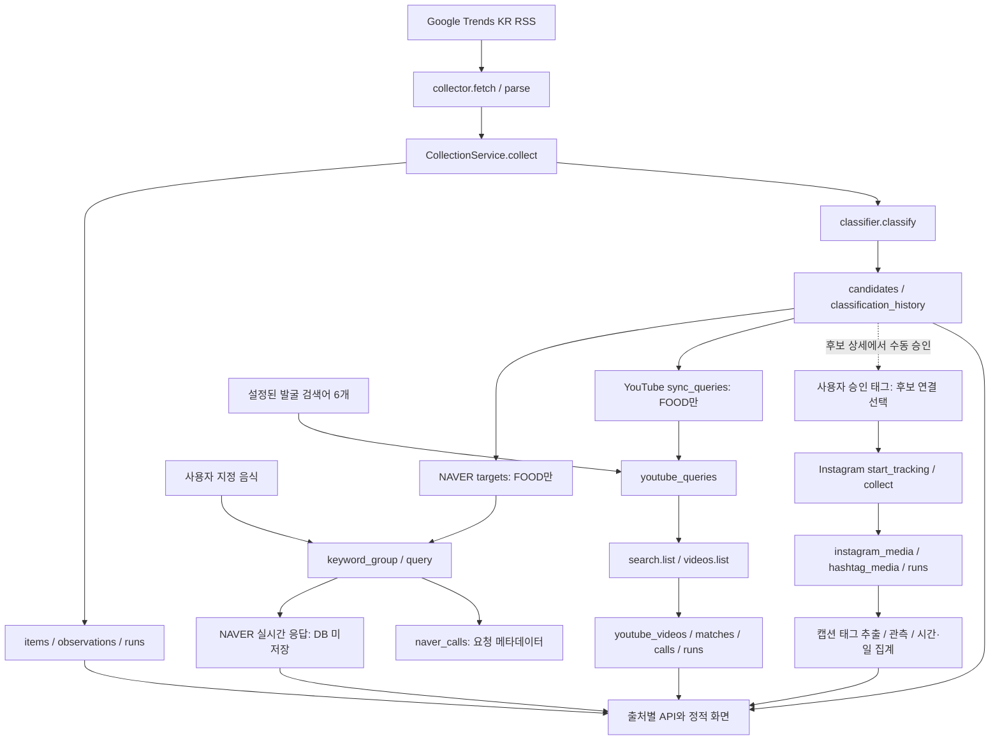
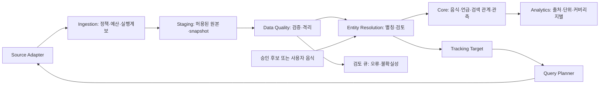

# MVP 수집 시스템 통합 감사 및 Oracle 아키텍처 설계

감사일: 2026-10-26 KST. **구현 전 읽기 전용 감사**이며 아래 목표 모델·인터페이스·로드맵은 모두 제안이다.

DB 기준 시각은 **2026-10-26 15:47:41 KST**(`06:47:41 UTC`)다. 실행 중인 수집을 중단하지 않았으므로 이후 화면 수치가 달라도 이 스냅샷의 오류를 의미하지 않는다. 추가 품질 집계는 별도의 읽기 트랜잭션에서 확인했다.

산출물: 본문 A·B는 이 문서, C는 [Oracle 모델 명세](ORACLE_MODEL.md), D는 [탐지→추적 계약](TRACKING_DESIGN.md), E는 [개발 로드맵](ROADMAP.md)이다. 실제 DB 스키마·SQL·집계는 [evidence.json](evidence.json), 보완 품질 통계는 [quality-detail.json](quality-detail.json), 격리 검증은 [additional-verification.json](additional-verification.json), 테스트는 [test-summary.json](test-summary.json)과 [로그](offline-tests.log)에 있다. 증거 파일은 인증값·캡션·영상 제목·작성자 정보를 포함하지 않는다.

## 1. Executive Summary

**4개 수집원은 존재하지만, 음식 개체 중심의 통합 탐지·추적·분석 시스템은 아직 부분 구현이다. 기존 transport·파서·출처별 예산·보존 처리는 재사용하고, 음식 식별·요청 계획·관측 계약을 그 위에 추가하는 방향을 권고한다.**

| 판단 | 현재 확인 결과 | 상태 |
| --- | --- | --- |
| 수집 연결 | RSS 저장 응답 및 Instagram/NAVER/YouTube 기존 실제 검증 자료 존재. 이번 감사에서 새 외부 수집 0회 | 구현 및 동작 검증 완료: 저장 증거 범위 |
| 음식 탐지 | RSS 규칙 분류만 후보 생성. 최신 264건에 FOOD 0, REVIEW 1, NON_FOOD 263 | 부분 구현 |
| 자동 추적 연결 | NAVER·YouTube가 FOOD 후보를 읽음. Instagram은 승인 태그 추적. 현재 자동 음식 대상은 0 | 부분 구현, 실제 FOOD 연결 미검증 |
| 공통 음식 ID | `youtube_foods`만 출처 내부 ID. 공통 엔티티·별칭 이력·음식 언급 모델 없음 | 미구현 |
| 원본·품질 | RSS 성공 70회 원본 ↔ 관측 700건 일치, DB 무결성 정상 | 구현 및 동작 검증 완료 |
| 통합 분석 | 단위·커버리지·비교 조건을 보존한 공통 집계 없음 | 미구현 |
| 통합 전 결함 | RSS 후보 REPLACE가 YouTube 후보 연결을 삭제함: 임시 DB에서 1→0 재현 | 설계상 결함 또는 개선 필요 |
| 보존 정책 | NAVER 결과 미저장 유지 필요. YouTube 파생 분석은 비활성화. Instagram 장기 보존 권한은 미확인 | 설계상 결함 또는 개선 필요 / 정책 확인 필요 |

현재 운영 DB의 물리적 손상·외래키 위반·잘못된 음식 병합은 확인되지 않았다. 다만 현재 음식 양성이 없어 앞으로의 연결 경로가 안전하다는 뜻은 아니다. 자동화 테스트 **97개 통과, 실패·오류·건너뜀 0**이다. 테스트 통과는 실제 장기간 수집·음식 탐지 정확도·이용조건 준수를 보증하지 않는다.

이번 작업은 기존 코드·`.env`·데이터를 수정하지 않았다. DB는 SQLite URI `mode=ro`, `query_only=ON`, 읽기 트랜잭션으로 접근했고 앱 `Storage`나 서비스 초기화를 운영 DB에 실행하지 않았다. 이 초기화와 일부 상태 API에는 쓰기·만료 정리 부작용이 있기 때문이다. 기존 테스트와 결함 재현은 임시 DB에서만 수행했다. 테스트 프로세스는 운영 DB 접근과 외부 소켓 연결을 차단했고 외부 연결 시도 0회, 검사 대상 소스·정적 파일·테스트·`.env` 변경 0개였다. 기존 서버 재시작·기존 작업 중단·재분류·마이그레이션·Oracle 생성은 수행하지 않았다. 공개 공식 문서 조회만 별도로 수행했다.

## 2. 현재 아키텍처

### 2.1 실제 구현 흐름

점선은 자동 이벤트 연결이 아닌 사용자의 승인 경로다. YouTube 발굴 검색 결과에서 `candidates`로 돌아가는 경로, Instagram 공동 태그에서 음식 후보를 만드는 경로, NAVER 지수를 장기 분석에 넣는 경로는 없다.

근거: [collector.py](../../food_trends/collector.py) `fetch/parse`, [service.py](../../food_trends/service.py) `CollectionService.collect/start`, [storage.py](../../food_trends/storage.py) `finish/_classify`, [naver_service.py](../../food_trends/naver_service.py) `targets/query_keywords/collect`, [youtube_storage.py](../../food_trends/youtube_storage.py) `sync_queries`, [instagram_service.py](../../food_trends/instagram_service.py) `start_tracking`, [api.py](../../food_trends/api.py) `make_server`.

### 2.2 DB·트랜잭션·마이그레이션

현재 DB는 `data/trends.sqlite3`, 6,676,480 bytes(약 6.37 MiB), SQLite WAL 모드다. ORM 없이 `sqlite3`와 SQL을 직접 사용한다. Python 표준 라이브러리 HTTP 서버와 정적 HTML/JS이며, [__main__.py](../../food_trends/__main__.py)에서 출처별 서비스·스레드를 생성한다. 서버가 정지된 동안 수집은 진행되지 않는다. 실제 실행 중 서버의 환경변수·스레드 상태는 이번 감사에서 조회하지 않았다.

| 계층 | 실제 테이블 전부: 총 30개 | 관계·제약·운영 특징 |
| --- | --- | --- |
| RSS 5개 | `runs`, `items`, `observations`, `candidates`, `classification_history` | items.source_id UNIQUE, observations(run_id,item_id) PK, candidates.item_id PK/FK. 분류값 CHECK 없음 |
| Instagram 13개 | `instagram_hashtags`, `instagram_candidate_hashtags`, `instagram_media`, `instagram_hashtag_media`, `instagram_runs`, `instagram_searches`, `instagram_metrics`, `instagram_state`, `instagram_leases`, `instagram_caption_analysis`, `instagram_caption_tags`, `instagram_analysis_observations`, `instagram_observation_tags` | 사용자+태그 UNIQUE, 게시물 ID PK, 태그↔게시물 M:N, 후보↔태그 M:N, 관측별 추출 태그. 출처별 lease |
| NAVER 3개 | `naver_targets`, `naver_calls`, `naver_guards` | 후보 ID PK/FK, 날짜 인덱스, 요청 fingerprint PK 잠금. 결과 테이블 없음 |
| YouTube 9개 | `youtube_foods`, `youtube_candidate_foods`, `youtube_queries`, `youtube_videos`, `youtube_matches`, `youtube_calls`, `youtube_state`, `youtube_runs`, `youtube_video_provenance` | name UNIQUE, (query,mode) UNIQUE, 영상 PK, query↔video M:N. 후보·영상의 일부 FK에 CASCADE |

정확한 컬럼·기본값·PK/FK·인덱스 목록·DDL은 `evidence.json.schema`에 30개 모두 기록했다. 대다수 상태·날짜·JSON 필드는 TEXT이며 상태 enum·JSON 유효성·시각 순서의 DB CHECK는 부족하다. 핵심 인덱스는 RSS keyword, Instagram 검색 7일 창·태그 회차·분석 관측 창, NAVER calls.day, YouTube calls(day,endpoint)·expires_at이다. 모든 FK가 조회용 인덱스로 보강된 구조는 아니다.

`Storage.connect()`는 foreign_keys=ON, timeout=10초, connection context의 성공 commit/예외 rollback을 사용한다. RSS 회차 시작은 별도 commit, 결과 항목·관측·분류·완료 처리는 하나의 트랜잭션이다. Instagram 회차 시작과 완료 저장은 분리되며 완료 저장 안에서 게시물·분석·집계가 묶인다. NAVER와 YouTube는 외부 요청 전 `BEGIN IMMEDIATE`로 예산/잠금을 예약하고 결과를 별도 저장한다. 외부 HTTP와 DB를 하나의 원자적 트랜잭션으로 묶지는 못한다.

마이그레이션은 서비스 생성자의 `CREATE TABLE IF NOT EXISTS`와 `PRAGMA table_info` 후 `ALTER TABLE ADD COLUMN`이다. 버전 테이블·순서가 보장된 마이그레이션 파일·다운그레이드 절차는 없다. `YouTubeStore.__init__/status/videos`는 purge를 호출하고 `sync_queries`는 테이블을 갱신한다. `NaverService.status()`도 `targets()`를 통해 대상을 upsert한다. `HashtagAnalysis.__init__()`는 기존 캡션 재분석까지 실행한다. **조회 명령 또는 앱 기동을 읽기 전용 감사 수단으로 사용하면 안 된다.**

작업 폴더에서 Git 저장소와 적용 가능한 AGENTS.md를 찾지 못했고 `git status`는 저장소 아님을 반환했다. 브랜치·커밋·워크트리·tracked 여부는 미확인이다. 새 저장소 생성이나 Git 변경은 하지 않았다.

## 3. 수집원별 감사 결과

### 3.1 구현 전수 비교

다음 기본값은 코드 및 감사 자식 프로세스가 읽은 설정 기준이며 실행 중 서버에 적용됐다고 단정하지 않는다. 네 출처의 자격증명 존재는 값 출력 없이 확인했다.

| 항목 | Google RSS | Instagram | YouTube | NAVER DataLab |
| --- | --- | --- | --- | --- |
| API·인증 | `GET https://trends.google.com/trending/rss?geo=KR`; 인증 없음 | Graph `v26.0`; Bearer 사용자 토큰 | `https://www.googleapis.com/youtube/v3/search`, `/videos`; X-Goog-Api-Key | `POST https://naverapihub.apigw.ntruss.com/search-trend/v1/search`; X-NCP-APIGW-API-KEY-ID/KEY |
| 역할 | 급상승 검색 대상의 음식성 분류 | 승인 태그의 게시물 추적·공동 태그 분석. 음식 자동 발굴 아님 | 설정된 광역 발굴 검색+RSS FOOD 추적 검색. 후보 추출은 비활성 | 이미 지정한 음식/FOOD 후보의 상대 관심도 조회 |
| 요청 조건 | geo=KR 고정 | ig_hashtag_search(user_id,q), `{id}/recent_media`, fields=id,caption,timestamp,media_type,permalink, limit=50 | part=snippet,type=video, KR/ko, order=date, 초기 최근7일, 고정 상한, maxResults=50. 상세 최대50 ID/배치 | 기본 어제 KST까지30일, 7/30/90 UI, date, 최대5그룹×5별칭. 내부 함수에 week/month·성별·기기·연령 필터 |
| 응답·실사용 | XML title/pubDate/approx_traffic/link/news_item/related_* → keyword, 게시 시각, 대략 트래픽, 뉴스, 관련어, XML, provided_fields | data[]+paging → ID·캡션·게시 시각·유형·링크. paging.next는 직접 방문하지 않고 after 재구성 | search items.id.videoId/nextPageToken 사용, 검색 snippet은 형태만 확인. 상세 snippet/statistics/contentDetails/status에서 제목·설명·채널·썸네일·시각·통계·길이·공개상태 | startDate/endDate/timeUnit/results[title,keywords,data(period,ratio)] 검증·표시. raw body·지수 미저장 |
| 주기 | 즉시 시작 후 기본1800초 | 활성 태그60분, 루프 최대60초. 로컬 토큰 만료 시 차단 | 기본21600초, 실행당 최대8검색어, 지속 next_run_epoch | 60초 점검, 음식 주제별86400초. FOOD 없으면 API 요청0 |
| 페이지네이션 | 없음. 반환 feed만 | 기본최대20페이지, 커서 반복 검사, more 남으면 limited | 기본1페이지, 상한·토큰·하한 DB 보존, 토큰7일, 완료 watermark 상한-10분 | 없음, 최대5주제 배치 |
| 예산·동시성 | 프로세스 내부 Lock. 중앙 호출 예산 없음 | 7일 고유태그30, soft28; 원격 최근검색 교차검사; DB lease5분, 요청 전 갱신. 플랫폼 총 HTTP 예산 별도 미구현 | search40/일·videos1000/일 자체 상한; PT 날짜·재시도별 예약, quota 차단; lease180초 갱신 | KST100회/일 자체 상한, 재시도 포함 예약, DB fingerprint guard600초·완료후60초. 전체 API키 사용량은 모름 |
| 오류·재시도 | 예외·HTTP 상태·원본 기록. 즉시 재시도 없음, 다음 주기 | 인증/권한/한도/네트워크/5xx 분류, 최대3시도 지수대기. 부분 데이터 보존. Retry-After를30초로 제한하는 점 재검토 필요 | network/5xx 최대3시도, 42960초, 인증/권한6시간, quota PT 다음날. 잘못된 상세는 checkpoint 전진 안 함 | network/5xx/429 최대3시도; 긴 Retry-After는 cooldown, 인증 즉시 중단 |
| 중복 | source URL+원검색어+UTC 게시 시각+링크 SHA256. 회차 내 ID set, 관측 복합 PK | 게시물 전역ID, (태그,게시물) PK. 같은 게시물의 여러 태그 관계는 별도 | 영상ID PK, (query,video) PK. 별칭 쿼리 간 호출과 검색 관계는 별개 | keyword_group의 정확 별칭, 동일 주제 배치 통합, 정렬 body SHA256 guard. 영구 음식ID 없음 |
| 저장·이력 | 전체 RSS BLOB, 최신 item payload, 회차별 payload·당시분류, 이전분류 | 최신 캡션 및 별도 관측 태그. 기존67건은 legacy_snapshot. 태그별 신규량 hour/day | 최신 영상29일 TTL, 검색 매칭29일 TTL, 호출/회차·출처 이력. 통계 시계열은 없음 | 호출 조건·상태·후보ID·fingerprint만. 결과 캐시·DB 저장 없음 |
| UI | `/api/status`, `/api/trends`, 상세·export, static/app.js | `/api/instagram`, media(캡션 제외), 시작/중단/재개/수집/check; static/instagram.js | `/api/youtube`, collect/refresh/delete; static/youtube.js | `/api/naver`, query/collect; static/naver.js, 사용자 지정 음식 |
| 재사용 | 안전한 XML 파싱, 원본 보존, 분류 버전·근거, 원본 대조 | 안전한 Graph URL·비밀값 처리, 태그별 lease/예산, 관측·공동 태그 모델 | strict parser, ID중복·checkpoint·TTL·origin 분리 | 요청·비율 검증, 상대지수 의미, 비저장, 별칭 배치·guard |

주요 함수 위치: RSS `collector.py:23`, `storage.py:85`; Instagram `instagram_graph.py` `GraphClient.get/pages/recent`, `instagram_service.py` `normalize/clean_media/_collect_tag`, `instagram_storage.py:156`, `instagram_analysis.py:116`; YouTube `youtube.py` `get/parse_video`, `youtube_service.py:59/124`, `youtube_storage.py:98/116/145/166`; NAVER `naver_datalab.py` `request_body/parse_response/NaverClient.search`, `naver_service.py:45/100/157`.

구현 상태는 기능별로 다음과 같이 구분한다. 실제 연결 성공과 자동 음식 추적 성공을 같은 상태로 표시하지 않는다.

| 출처 | 구현 및 동작 검증 완료 | 구현되어 있으나 실제 동작 미검증 | 부분 구현·미구현·개선 필요 |
| --- | --- | --- | --- |
| RSS | 저장 원본 파싱·관측 대조, 분류 저장, 격리 API 테스트 | 장기간 연속 수집과 실제 음식 탐지 정확도 | 빈도·증가율·신규성 탐지 미구현, 공통 음식 식별 미구현 |
| Instagram | 기존 승인 태그 수집·중복 방지·캡션 태그 관측, 현재 DB와 기존 검증 결과 일치 | 충분한 기간의 실제 시간·일 추이, 여러 별칭 태그의 음식 단위 집계 | 후보와 자동 연결 미구현, 4회 모두 수집 범위 제한, 공통 음식 ID 미구현 |
| YouTube | 기존 live search/detail 각 1회 및 5영상 갱신, 격리 페이징·예산·TTL 테스트 | 실제 FOOD 후보에서 tracking 검색으로 연결, 장기 자동 운영 | 검색 수집은 구현, 음식 후보 추출·파생 분석은 비활성/미구현, legacy 출처 보완 필요 |
| NAVER | 기존 사용자 음식 7/30/90일 실제 검증, 요청·오류 메타데이터 및 격리 계약 테스트 | RSS FOOD 발생 후 자동 전송·24시간 주기 실제 실행 | 공통 대상·음식 ID 부분 구현, 결과 영구 저장은 권한 미확인으로 미제공 |

### 3.2 실제 데이터 건수와 유효성

여기서 ‘구조상 유효’는 ID·필수 시각·JSON 등 확인한 형식에 문제가 없다는 뜻이다. 실제 음식 여부·신규성·유행을 인정한 건수와 다르다.

| 실측 항목 | RSS | Instagram | YouTube | NAVER |
| --- | ---: | ---: | ---: | ---: |
| 저장 단위·전체 수 | 항목 264, 관측 700 | 게시물 72, 태그↔게시물 72, 분석 관측 167 | 영상 253, 검색 관계 277 | 호출 시도 10, 대상 0, 저장 시계열 0 |
| 구조상 유효 | 264/264, 잘못된 JSON 0 | ID·시각·링크·유형 결측 0/72 | ID·제목·게시 시각·channel_id 결측 0/253, 잘못된 JSON 0 | HTTP200 성공 7/10. 시계열은 저장하지 않아 건수 미확인 |
| ID 중복 저장 | 0/264 | 0/72 | 0/253 | 결과 레코드 없음 |
| 재관측·중복 의미 | 원문 문자열 259개, 4개 문자열이 복수 게시 시각에 등장해 5개 항목이 추가됨. 정상적인 별도 항목 | 반환 217행=신규 72+중복 145. 4회 모두 limited | 23개 영상이 여러 query에 일치. 고유 253개 대비 관계 277개로 24개 관계 추가 | 재시도는 독립 호출 시도. 응답 중복률 산정 불가 |
| FOOD / REVIEW / NON_FOOD | 0 / 1 / 263, 미분류 0 | FOOD 분류 없음. 태그 일치와 음식성은 별개 | FOOD 분류 없음. 검색 일치의 실제 내용 미검증 | FOOD 대상 0. 수동 조회 10건은 candidate_ids=[] |
| 음식 관련 실측률 | 분류상 FOOD 0/264=0%, REVIEW 1/264=0.38%. 실제 음식률 미평가 | 음식 확정률 미평가. 캡션에서 기준 태그를 확인한 게시물 46/72 | 실제 음식 관련률·FOOD 비율 미평가 | 지정 검색어 조회이므로 콘텐츠 중 음식 비율이라는 분모는 적용하지 않음 |
| 음식 개체 연결 | 공통 food_id 없음 | 후보↔태그 0, 공통 food_id 없음 | youtube_foods=0, 후보 연결 0, tracking query 0 | naver_targets=0, 공통 food_id 없음 |
| 실수집/Mock | origin 열 없음. 저장 RSS 70회와 관측 700건의 정합 확인. 테스트 fixture는 별도 DB | origin 열 없음. 기존 실제 검증과 반환 217행·저장 72건 대조. 행별 live 증명 미구현 | live_api 5/253=1.98%, legacy_unknown 248/253=98.02%, 명시적 mock 0. legacy는 실수집·Mock 어느 쪽으로도 확정 불가 | origin 열 없음. 기존 실제 검증과 성공 이력 대조. 전체 10건의 행별 live 증명은 불가 |

결측 상세:

- RSS: 게시 시각·검색어·traffic 결측 0/264. 뉴스 없음 **7/264=2.65%**, 관련검색어 미제공 **264/264=100%**. 수집 당시 분류 JSON 미기록 **530/700=75.71%**이며 170건만 존재한다. 과거 미기록을 현재 결과로 채우면 안 된다. 분류 이력 242건은 별도 보존되어 있다.
- Instagram: 캡션 없음 **1/72=1.39%**, 태그 없는 캡션 **19/72=26.39%**, 태그 추출 가능 **52/72=72.22%**, 캡션 보유71/72. 관련 태그185종은 기준 태그 제외 값이며 기준 포함 고유태그는186종이다. 관측167건=API 관측100+legacy_snapshot67. 기준 태그 확인46/72=63.89%는 캡션 기반 확인율이며 API 검색의 정답률이 아니다.
- YouTube: 설명 없음 **44/253=17.39%**, like_count 미제공 **10/253=3.95%**, comment_count 미제공 **5/253=1.98%**. view_count 누락0. nullable count를0으로 바꾸지 않는다. 만료 영상0/253. 통계는 문자열로 정확도를 보존하며 JS 정수 안전범위 밖도 지원한다.
- NAVER: 응답 시계열을 DB에 저장하지 않으므로 누락 period·값의 전체 실측 통계는 산정 불가다. 성공7/10=70%는 로컬 시도 대비 성공률이며 3건 네트워크 실패에 HTTP 응답은 없었다. 원격 실제 차감량 또는 검색어별 데이터 충실도를 의미하지 않는다.

NAVER의 과거 성공 이력 중에는 기존 실환경 보고서가 명시한 **한글 인코딩이 깨진 진단 요청 1회**도 포함된다. 따라서 성공 7건 전부를 정상 음식 조회로 세면 안 된다. `query_keywords`는 문자열 형식을 검증하지만 음식 여부를 판정하지 않는다. 기존 ‘NON_FOOD 거부’ 검증은 후보 ID 경로에 대한 것이며 사용자 지정 문자열 전체에 음식 필터가 있다는 뜻은 아니다.

시각 범위(KST):

| 출처 | 최초→최근 관측/시도 | 원본 게시 시각 또는 유효 기간 |
| --- | --- | --- |
| RSS | 10-13 14:30:13 → 10-26 15:34:23 | 게시 10-13 11:50 → 10-26 14:30 |
| Instagram | 10-26 14:27:22 → 15:28:07 | 게시 10-25 14:57:03 → 10-26 15:22:29 |
| YouTube | 최초 저장 10-26 15:22:29, 최근 갱신 15:31:13 | 게시 10-19 17:30:14 → 10-26 14:46:18. 가장 빠른 만료 11-24 15:22:29 |
| NAVER | 10-26 14:22:09 → 14:54:59 | 요청 조건은 naver_calls.request_json에 보존, 지수 원문 없음 |

회차 결과: RSS75회=성공70+실패5(TimeoutError2, URLError2, OperationalError1), 미완료0. 실패 run60은 HTTP200 뒤 저장 오류로 원본은 남고 항목·신규0이다. 기존 `AUDIT_REPORT.md`의 구버전 INSERT 스키마 충돌 기록과 부합한다. Instagram4회 모두 `limited/truncated=1`, 완전 커버리지 성공0/4, 실패·partial 저장 회차0. YouTube17시도=HTTP200 14+네트워크3이며 live_api는 search1+videos1, 나머지15시도는 legacy_unknown이다. 새 형식 `youtube_runs`는1회만 존재한다. 모든 출처의 미완료 회차/시도는 현재0이다.

### 3.3 기존 보고서와 교차 검증

| 기존 자료 | 현재와의 관계 |
| --- | --- |
| `AUDIT_REPORT.md` 최종 RSS243/570/62회 | 현재264/700/75회로 증가. 고정된 과거 감사값을 최신값으로 재사용하지 않음 |
| `INSTAGRAM_HASHTAG_ANALYSIS.md` 70건·164태그 | 토큰 적용 전 수치. `INSTAGRAM_TOKEN_APPLICATION.md`의72건·185관련태그가 현재와 일치 |
| `data/instagram-approved-token-verification.json` | 기존 실제 검증 기록 및 무결성 확인. 이번 감사는 토큰 재검사·API 재수집 안 함 |
| `NAVER_LIVE_VERIFICATION.md` 및 JSON의8시도·성공5 | 이후 재시작 검증 등이 누적되어 DB10시도·성공7. 음식 자동 대상은 계속0 |
| `data/youtube-live-verification.json` | 실제 search1+detail1, 기존5영상 갱신, 신규0, 음식연결0이 DB origin·회차와 일치 |
| 기존 테스트 로그 | 과거30/54/90/91개 등은 해당 시점 기록. 현재 코드로 격리 재실행97개 통과 |

이번에 기존 브라우저 수집 스크립트는 실행하지 않았다. 일부는 실제 수집 버튼을 누르므로 읽기 전용 감사에 부적합하다. UI 연결은 라우트·JS·기존 브라우저 검증 JSON 및 현재 격리 API 테스트로 확인했으며 최신 실제 화면은 재검증하지 않았다.

### 3.4 출처별 정책과 저장 의미

| 출처 | 현재 구현 | 공식 문서 확인과 이번 설계 결정 |
| --- | --- | --- |
| RSS | XML·항목·관측 무기한 보존, 기사본문 추가 수집 없음 | RSS 제공이 무제한 영구 보관·재배포 허가라는 근거는 미확인. 기존 보존 상태와 신규 권한 판단 분리. 신규 목표의 원본 보존 기간은 정책 확인 후 결정 |
| Instagram | 캡션 기본30일, 동일 캡션 반복으로 만료 연장 안 함. ID·링크·태그·관측은 별도 만료 없음 | Meta 공식 Hashtag/Platform Terms를 열었으나 접근 제한으로 현행 상세 확인 불가. 30일은 앱 선택값이며 공식 허용기간으로 주장하지 않음. 파생 태그·백업까지 보존 근거 확인 전 무기한 확대 금지 |
| YouTube | 영상/매칭29일, 최신 snapshot, 파생지표·분류·음식 추출 비활성 | 공개 비승인 API 데이터의30일 갱신/삭제 및 파생지표 승인 요건 확인. 기존29일·미분석 운영을 보존. 승인 없는 장기 통계 이력·음식 추출·통합점수 활성화 안 함 |
| NAVER | 응답/캐시/시계열 미저장, 요청·성공·한도만 저장 | 공식 API 문서는 ratio 및 요청 조건을 설명하지만 장기 저장·가공물 보관 권한을 확정하지 못함. 결과 영구 저장 제안 안 함. 허용 범위 확인 전 Oracle에도 운영 메타데이터만 |

YouTube 정책 근거: [개발자 정책 III.E.4·III.L](https://developers.google.com/youtube/terms/developer-policies), [추가 파생지표·보존 승인 정책](https://developers.google.com/youtube/terms/derived-metrics-policy). 추가 승인 정책의 존재를 이 앱의 승인 증거로 간주하지 않는다. 기존 앱의 음식 추출 보류는 이 정책에 대한 보수적 운영 선택이다.

NAVER 근거: [API 명세](https://api.ncloud-docs.com/docs/naver-api-hub-search-trend), [사용 가이드](https://guide.ncloud-docs.com/docs/apihub-overview), [약관 동의 절차](https://guide.ncloud-docs.com/docs/apihub-application). API 명세는 그룹당20개, FAQ는5개여서 구현의5개 상한을 유지한다. 현행 가이드는 검색어 트렌드 월50,000회·키당50RPS 및 한시적 무료를 안내한다. 실제 계정 이용한도·요금은 콘솔 미접속으로 미확인이다.

YouTube 현행 [할당량 표](https://developers.google.com/youtube/data/determine_quota_cost)는 search.list 별도100회/일, 기타 API10,000유닛/일, videos.list1유닛, PT 자정 초기화를 명시한다. 과거의 search100유닛 모델을 이번 설계에 섞지 않는다. 이 앱의40/1000은 더 낮은 로컬 상한이며 다른 앱의 소비량을 알 수 없다.

## 4. 데이터 품질 및 구조적 문제

### 4.1 위험·근거·재현·의존성

P0는 통합 전 차단 항목, P1은 연결 구축 중 필수, P2는 후속 개선이다. **Critical이 실제 운영 데이터에서 발생했다고 확인한 건은 없다.** F01은 조건부 연결 손실이 격리 재현되어 High로 분류하며 핵심 연결이 이에 의존하면 Critical로 승격할 수 있다.

| ID·위험·우선순위 | 실제 근거와 영향 | 재현/검증 | 권장 방향·선행 의존성 |
| --- | --- | --- | --- |
| F01 High/P0 | `storage.py:62` REPLACE와 `youtube_storage.py:33` CASCADE 조합으로 후보 재저장 시 youtube_candidate_foods 삭제. 운영 연결0이라 운영 손실은 미관측 | 임시 FOOD후보→sync_queries→동일RSS재수집: 연결1→0. additional-verification.json | 기존 행 UPDATE 기반 UPSERT, RSS 재수집·재분류 중 연결 유지 회귀검증. Oracle보다 먼저 수정; 선행 없음 |
| F02 High/P0 | 공통 음식·후보승인·일관된대상 없음. 현재 RSS FOOD0, NAVER대상0, YouTube음식0, IG후보연결0 | schema·함수 경로와 실제 counts | FOOD_ENTITY/ALIAS·수동 등록·승인 계약. 선행 F01, 유형·정책 계약 |
| F03 High/P0 | `classifier.py:89` FOOD_BRAND도 FOOD로 반환, NAVER/YouTube는 classification만 필터. 브랜드를 음식으로 자동 추적 가능 | 기존 `test_audit_improvements.py` 브랜드 FOOD 사례와 targets/sync_queries 조건 확인. 현재 운영 양성0이라 오추적 미관측 | 브랜드·매장·음식 유형 분리, 음식 승인 gate. 선행 분류 taxonomy 및 사람 검토 기준 |
| F04 High/P0 | YouTube248/253 origin 미기록, RSS/IG/NAVER 행별 origin 없음 | provenance LEFT JOIN, origin별 calls, schema | legacy_unknown 격리, 신규 수집 origin 필수. 재검증 없는 live 역기입 금지. 선행 공통 ingest 계약 |
| F05 High/P0 | YouTube277매칭을 단순합하면253고유보다24건 과대. IG 별칭 태그를 추후 추가하면 같은 게시물이 여러 타깃에 속할 수 있음 | yt_overlap 23영상, 초과관계24. 현재 IG 다중기준태그게시물0 | 콘텐츠·언급·검색 관계 별도키, food/source/day별 distinct item. 선행 공통 entity·match 모델 |
| F06 High/P0 | Instagram4회 모두limited, successful_runs0. 저장72를 플랫폼 전체 발화량이나 날짜간 실제 수요로 해석 불가 | runs.truncated 및 metrics; 관측 기간 약1시간 | coverage·페이지상한·요청창 포함, 미관측/실패/부분/관측0 구분. 선행 지표 정의 |
| F07 High/P0 | NAVER 영구보존 권한 미확인, YouTube 분석 미승인, Instagram 태그·메타 만료 없음 | 정책 문서·보존함수·DB테이블 | 출처·데이터종류별 policy gate/TTL/삭제 전파. 기존 NAVER 미저장 유지. 선행 공식 조건 또는 승인 범위 확보 |
| F08 Medium/P1 | RSS 과거분류미기록530/700, IG legacy_snapshot67/167, YouTube 최신통계만 | quality-detail/evidence | 과거 값을 재구성한 사실로 기록하지 않음. snapshot·규칙버전·evidence_kind 보존. 선행 snapshot·계보 모델 |
| F09 Medium/P0 | 상태조회가 대상upsert·purge·query sync 수행. 초기화는 DDL·캡션재분석도 수행 | NaverService.status/targets, YouTubeService.status, HashtagAnalysis.__init__ | 순수 read 상태조회와 maintenance/명시마이그레이션 분리. 선행 없음 |
| F10 Medium/P1 | RSS프로세스내Lock만, 공통스케줄·outbox·중앙예산 없음. 동명별칭별 별도query는 호출중복 가능 | service.py:11, 각 source service의 독립 locking·쿼리 모델 | lease·작업idempotency·동일 요청 공유·별칭별 필요성 평가. 선행 대상·query 모델 |
| F11 Medium/P1 | 전체JSON·상태·날짜 CHECK와 이관버전 통제가 약함. run60 구버전 INSERT 충돌의 실제 이력 | sqlite schema 및 run60, 기존 감사 | 버전 마이그레이션·명시컬럼 SQL·행타입검증. 선행 인터페이스 안정화, Oracle버전 선택 |
| F12 Medium/P2 | RSS원본·관측 무기한 증가, IG원문 만료 후 전체 재추출 불가, 장기 분석복원성 제한 | runs BLOB, observations, purge_expired | 승인된 원본만 TTL·보존 정책, 재처리불가 상태 명시·증분집계. 선행 F07/F08 |
| F13 Low/P2 | YouTubeStore가 NAVER keyword_group에 의존. RSS는 NFC/공백, IG는 casefold·태그문법 등 서로 다른 책임 혼재 | youtube_storage.py import, normalize 함수들 | 공통문자정규화/개체해결/출처query직렬화 분리. 선행 alias 규칙 확정 |

알려진 비밀값으로 루트 보고서·로그, data의 직접 하위 JSON·로그, 소스·정적 파일 **86개**를 검사해 일치0개였다. 이는 알려진 현재/직접하위 secret 파일의 값에 대한 제한된 검사이며 브라우저 프로필·모든 과거 백업·알 수 없는 토큰까지 무노출을 증명하지 않는다. `.secret`와 `.env`는 의도된 비밀 저장소이며 내용은 보고서에 복사하지 않았다.

### 4.2 FOOD가 없는 원인의 구분

1. **저장·파싱 누락 증거 없음:** 저장된 성공RSS70회 모두 재파싱하고 회차별700관측의 전체 dict를 대조해 불일치0, 응답내 중복ID0, 원본결측0이었다. 최초·최근시각 역전0, 미분류0이다. 성공응답은 회차당10항목이었다.
2. **수집원 범위 한계:** 전체한국급상승 feed에 음식이 반드시 포함되지는 않는다. 현재 keyword에서 두쫀쿠·두바이 표기0, 최신 저장 FOOD0이다. 기사배경에 음식이 있다는 이유로 그 검색 대상 자체를 음식으로 올리면 안 된다. RSS 원검색어와 별개인 기사 속 음식명을 추출하는 기능도 없다.
3. **분류기 한계:** 현재 REVIEW는 호박(id89, UNKNOWN, 규칙점수25)1건. 기존 감사는 v1의 음식오탐과 식재료누락을 기록했고 v2가 이를 일부 개선했다. 규칙점수는 확률·유행점수가 아니다. 고정형태·짧은제목에 의존하므로 신조어·동형어·간접설명 미탐은 남는다.
4. **탐지 파이프라인의 기능 한계:** YouTube·Instagram의 콘텐츠는 저장되지만 음식 후보로 환류되지 않는다. FOOD0을 네 출처 전체에 음식이 없다는 뜻으로 해석하면 안 된다.
5. **미확인:** 현재264건에 대한 독립적인 사람 정답셋이 없어 실제 음식비율·미탐률·정밀도·재현율·F1은 산정하지 않는다. 기존243건 이후 추가된21건까지 사람이 전수 판정했다고 주장하지 않는다.

## 5. 탐지·추적 통합 가능성

| 단계 | 현재 | 부족한 부분 |
| --- | --- | --- |
| DISCOVERY | RSS 고정feed, YouTube 설정검색, Instagram 공동태그 관측 | 음식 후보를 만드는 실경로는 RSS뿐. 빈도·증가율·신규성 기반 발견점수 없음 |
| CANDIDATE | RSS items별 candidates 한 행, 원문·규칙·근거 | 음식실체와 출처항목 혼재, 사람이 승인/거절하는 영속업무 모델 없음 |
| ENTITY RESOLUTION | NAVER 명시별칭 한 그룹을 YouTube도 재사용 | 공통 ID·다의어·파생 음식·병합/분리·승인이력 없음 |
| TRACKING TARGET | IG 승인태그, NAVER FOOD대상, YouTube FOOD동기화 | 출처공통 상태·수집 주기·수동등록·종료정책 없음 |
| QUERY PLANNER | 출처별 직접 keyword 변환 | 정책/별칭/기간/예산을 반영한 공통계획과 중복 요청공유 없음 |
| SOURCE COLLECTOR | 네 출처별 구현 존재 | 공통실행/요청/품질/원본 보존 계약 없음 |
| OBSERVATION/ANALYTICS | IG관측·집계, RSS관측, YT최신영상, NAVER임시결과 | 의미·단위·비교조건·누락상태가 명시된 공통관측·집계 없음 |

사용자 지정 음식으로 **현재 가능한 것은 출처별 검증**이다. NAVER UI/CLI의 `query_keywords`는 후보를 만들지 않고 조회하며, Instagram CLI `--instagram-start`는 candidate_id 없이도 명시승인 추적이 가능하다. Instagram 웹 시작 API는 candidate_id를 요구한다. YouTube는 사용자 음식 등록 API가 없고, tracking은 RSS FOOD만 동기화한다. 따라서 음식 후보0이어도 **현행 전체 통합 파이프라인을 관통하는 검증은 불가능**하다. 향후 공통 수동 음식 등록→동일 resolution→target→planner 경로가 필요하다. 개발 시 먼저 Mock으로 전체경로를 검증하고 실제 호출은 출처별 별도 검증 범위 안에서 진행한다.

IG pause/resume은 존재하고 동일이름 재시작은 기존대상을 재사용한다. NAVER는 FOOD분류를 벗어나면 대상조회에서 제외되지만 명시적 사용자 중단/재개가 없다. YouTube sync는 FOOD·설정검색어 기준으로 active를 재계산하므로 개별 사용자 중단 상태를 지속관리하지 않는다. 과거관측 재처리와 API 재수집은 현재 공통작업으로 구분되지 않는다.

상세 계약·중복키·실패정책·자동화 예시는 [TRACKING_DESIGN.md](TRACKING_DESIGN.md)를 따른다.

## 6. 공통 데이터 처리 설계

현재와 다른 핵심은 수집어가 곧 음식ID가 되지 않고, 검색 일치가 곧 음식 언급이 되지 않는다는 점이다. NAVER 결과는 허용 전까지 메모리에서 검증·표시 후 종료하며 Staging/Core의 지수 저장을 통과하지 않는다. YouTube 파생 분석도 policy gate를 통과할 때까지 비활성이다.

| 처리 | 현재 | 목표 책임 |
| --- | --- | --- |
| 문자열 | RSS NFC+공백정리, IG 태그 casefold/문법, NAVER exact dictionary | 원문 보존+버전된 공통정규화. 출처검색 문법은 adapter 담당. 띄어쓰기제거·NFKC·특수문자삭제를 의미동일성 근거로 강제하지 않음 |
| 타입·필드 | 각 파서에서 검증, nullable보존 수준 상이 | 필드제공/비제공/빈값/파싱실패/만료삭제를 구분. source schema_version·provided_fields·quality_result 기록 |
| 콘텐츠중복 | RSS해시/IG ID/YT ID | `(source_id, external_key)` 유일. 출처간 복제는 related-copy 관계만, 동일 콘텐츠로 자동 병합 안 함 |
| 음식 언급중복 | 공통언급테이블 없음 | snapshot/필드/span/food/version 단위 증거. 본문내 반복 span과 콘텐츠내 고유음식 수를 분리 |
| 다중음식 | IG태그여러개·YT검색 관계여러개 | 한 item에 여러 FOOD_MENTION. 승인된 음식과 연결된 언급만 음식 분석에 포함 |
| 원본·추적 | RSS회차원본 우수, IG태그관측과 legacy 구분, YT최신snapshot | 허용원본·정규화snapshot·변환버전·resolution event 연결. 원문 만료 후 재처리불가를 명시 |
| 재처리 | RSS/IG 명령 존재, 후보REPLACE 부작용 | 원본이 남아 있고 정책이 허용한 범위에서 새 버전 결과 생성, 과거판정과 원시 관측 불변. API재수집 별도 계약 |

개체식별 순서 제안:

1. 승인된 **정확 별칭+scope** 사전: 가장 설명 가능하며 초기 우선순위. `두쫀쿠`, `두바이 쫀득 쿠키`, `두바이쫀득쿠키`는 승인된 EXACT_ALIAS로 같은 food_id에 연결한다. 실제 관측 문자열은 각각 보존한다.
2. NFC·공백·대소문자 등 문자열 정규화는 후보검색키로만 사용한다. 정규화 충돌이나 음식/브랜드 다의어가 있으면 검토한다.
3. 문자열 유사도는 top-k 후보 제시용이다. 짭쫀쿠를 두쫀쿠에 자동 병합하지 않는다. 파생 관계 근거가 확인되면 별도 food_id와 `VARIANT_OF`를 부여한다.
4. 한국어 로컬 임베딩은 별칭/설명 후보검색 보조로 선택 도입한다. 공개 사용 가능한 모델의 라이선스·한국어신조어 정답셋·CPU성능을 검증한 후 선택한다. 유사도 점수만으로 자동 병합하지 않는다. 외부 유료 LLM은 필수 의존성으로 두지 않는다.
5. 불확실·동형어·브랜드·연관개념은 ENTITY_REVIEW_QUEUE에서 승인·거절·신규 음식·파생·연관 결정을 남긴다. 임의의 유사도 임계값을 이번 감사에서 확정하지 않는다.

EXACT_ALIAS는 문자열↔음식 매핑이므로 FOOD_ALIAS로 모델링하고 FOOD_RELATION은 서로 다른 음식 간 `VARIANT_OF/RELATED_TO`를 담당한다. 두쫀쿠와 짭쫀쿠가 별칭인지 파생인지 최종판정하는 데이터는 현재 없다. 예시는 모델 설계 설명이며 새 사실등록이 아니다. 별칭 변경·개체병합/분리 시 변경전후 매핑과 결정을 저장하고 영향받는 언급·타깃·집계를 재계산한다. 과거 원시값을 덮어쓰지 않는다.

공통지표는 source/food/metric_code/unit/query_context/time_basis/period/coverage/origin을 갖도록 한다. RSS approx_traffic은 대략적 원문표현, Instagram은 관측한 고유게시물·공동태그 비율, YouTube view_count 등은 영상별 최신 snapshot, NAVER ratio는 특정 요청의 상대지수다. 서로 직접 합산하지 않는다. 요청 실패는 null/unknown이며 관측0과 다르다. 별칭 간 같은 콘텐츠는 음식·출처·일자 기준 union한다. 검색 결과에 나왔다는 관계만으로 음식 언급을 만들지 않는다. 주·월 고유 수는 일별 distinct를 더하지 않고 해당 기간의 item 집합에서 다시 계산한다. NAVER의 서로 다른기간 ratio를 접합하거나 더해 일관된 장기지수로 만들지 않는다. 통합 유행점수의 공식·가중치는 이번에 정하지 않는다.

## 7. Oracle 목표 아키텍처

선택안은 **출처별 수집기를 유지하면서 repository 계층을 추가해 Oracle로 단계적 이관**하는 방식이다. 검증 가능한 저위험 개발안은 로컬 Oracle AI Database 26ai Free와 Python `python-oracledb` Thin 조합이다. 현재 Oracle 서버·DSN·배포승인·설치버전은 미확인이고 감사에 사용한 Python3.12에는 oracledb가 설치되지 않았다. PATH에서 sqlplus/docker/podman도 찾지 못했으나 이것만으로 시스템 전체 미설치를 단정하지 않는다.

Oracle 공식 Free 한도는2코어·메모리2GB·사용자데이터12GB다. Python Thin은 별도 Oracle Client 없이 연결 가능하고 현재 Python3.11/3.12 코드와 사용할 수 있다. 운영 DB 버전을 확인한 후 드라이버 버전과 TLS·인증·네트워크 설정을 실제 검증해야 한다. [Free 한도](https://docs.oracle.com/en/database/oracle/oracle-database/26/xeinl/licensing-restrictions.html), [드라이버 설치·호환성](https://python-oracledb.readthedocs.io/en/stable/user_guide/installation.html).

필수12후보 테이블을 모두 검토하되, 원본snapshot·후보·품질·요청실행·다대다검색 근거·변경 이력이 필요하므로 보조 테이블을 추가한다. **NAVER 시계열과 YouTube 파생지표 테이블의 활성화는 정책 허용에 종속**된다. 목표 ERD·각테이블 PK/FK/자료형/UNIQUE/CHECK/인덱스/보존/이관매핑, 동시 UPSERT·크기예상은 [ORACLE_MODEL.md](ORACLE_MODEL.md)에 명시했다. 이 문서는 실행DDL이 아니며 DB를 생성하지 않는다.

현재 JSON/TEXT는 19c 호환안에서 `CLOB CHECK(IS JSON)`·BLOB, 26ai에서는 필요 시 native JSON을 검토한다. 시각은 `TIMESTAMP(6) WITH TIME ZONE` UTC, 집계일은 KST DATE(자정 제약), 외부ID는 문자열, 큰 count는 NUMBER 정수로 분리한다. Oracle의 빈문자열 NULL 취급 때문에 missing/empty를 상태로 보존한다. `INSERT OR REPLACE`, `ON CONFLICT`, `?`, SQLite datetime/PRAGMA는 Oracle SQL로 옮길 수 없으며 repository 구현을 분리해야 한다. JSON 및 타입의 공식 근거와 세부는 모델문서에 링크했다.

현재 DB크기가 작아 일괄이관은 기술적으로 가능하나, 수집을 계속 운영하고 출처별정책이 다르므로 단계전환이 적합하다. ①공통 계약·P0수정 → ②별도Oracle 스키마·테스트 → ③허용 범위의 읽기스냅샷 이관/행대조 → ④단일수집에서 동일관측을 목적지에 전달해 중복API없이 shadow검증 → ⑤출처별 단일쓰기소유 전환 → ⑥되돌리기검증 순서다. 즉시이중쓰기는 두 DB간 원자성을 보장하지 못하므로 outbox와 목적지 멱등성이 먼저다. NAVER 결과 재수집·YouTube 미기록 원본 복원은 이관으로 만들어낼 수 없다.

## 8. 우선순위별 개발 계획

작업별 목적·변경 대상·의존성·위험·테스트·완료 기준은 [ROADMAP.md](ROADMAP.md)에 정의했다.

| 구분 | 필수 작업 | 종료 조건 |
| --- | --- | --- |
| 연결 이전 | F01 UPSERT수정, 출처정책·origin·단위계약, 음식/브랜드 분리, 공통 음식·정확 별칭·승인·수동등록, 조회 부작용분리·버전 마이그레이션 | RSS반복저장으로연결유지, legacy격리, 후보0일때수동음식으로Mock경로진입, 승인없는source데이터분석차단 |
| 연결하면서 | target상태/주기, query planner/중복공유, API예약·lease·outbox, staging/DQ/언급·관측, 소스별adapter, Oraclerepository·이관대조 | Mock전체경로·실패 복구·두별칭동일 콘텐츠1회집계·정책별저장차단·DB행대조통과 |
| 연결 완료 후 | 독립사람정답셋·임베딩비교, 운영관측성확장, 장기성능/주·월 집계·보존최적화, 허용된출처에한정한탐지확장 | 기본연결안정, 정책 승인확인, 정확도·커버리지·성능목표를근거로기능선택 |

Oracle VECTOR·복잡한트렌드점수·전출처자동 발굴은 첫 연결의 선행 조건이 아니다. 다만 정책 확인, 잘못된 개체 병합방지, 원본과지표의의미보존은 선행 조건이다. 기존 정상수집기를 교체하는 대규모재작성은 권고하지 않는다.

## 9. 미확인 사항 및 추가 검증 필요 항목

- Oracle 실제 가용버전/서버/DSN/OS/메모리/포트/사용자권한/개발·운영배포방식. 이번에는 설치·연결·스키마생성 안 함.
- Meta 현행약관·앱별허용 범위와 캡션/식별자/태그/파생물/백업의 보존·삭제요건, Graph v26.0 향후지원. 공식 문서 접근제한으로 허용기간을 확정하지 않음.
- NAVER 현재동의약관 전문의 응답저장·캐싱·가공통계·재배포권한. 확인전 미저장 유지. 고객콘솔 실제 한도·요금·다른앱 소비는 미조회.
- YouTube 파생 음식 추출/분류/통합지표·장기보관의 앱별승인 존재여부. 현재 승인자료 없음. legacy248영상의 과거실행출처는 미확인.
- RSS 공식장기보존·재사용 조건, 원검색어 밖 뉴스본문 기반 탐지의 정확도와 권한. 기사본문은 이번에도 수집 안 함.
- 사람 검증정답셋·새음식실제양성·파생 음식관계증거. 사람 검토없이 정확도·미탐률이나 합병임계값 확정 안 함.
- 실행중서버의 실제스케줄/환경변수/브라우저최신상태와 24시간 이상연속실행. 수집중단없이 수행할 별도운영검증 범위를 후속정의해야 함.
- `instagram_state`의 저장된토큰 만료는 기존검증메타데이터이며 이번에 취소·권한변경·실제유효성을 새로 검사하지 않음.
- 지금없는 FOOD를 넣었을때네출처실제연결은 미검증. 향후승인된소량실제 호출은 목적·최대요청수·예산영향을 먼저 산정해야 함. 이번 작업에서는 요청하지 않았음.
- Git 메타데이터가 없어 기존브랜치·커밋·미커밋차이는 확인불가. 기존 파일을보존하고 보고서디렉터리만 추가함.

이번 감사의 결론은 저장기반이 손상되었다는 것이 아니라, **수집 성공과 음식 발견·개체해결·추적 성공을 구별할 공통 계약이 필요하다**는 것이다. 설계의 첫 인수 기준은 FOOD가 없는 경우에도 승인된 사용자 음식 하나로 동일한 Mock 추적 경로를 통과하고, 실제 출처데이터의 의미·보존 정책·관측제약을 유지하는 것이다.
