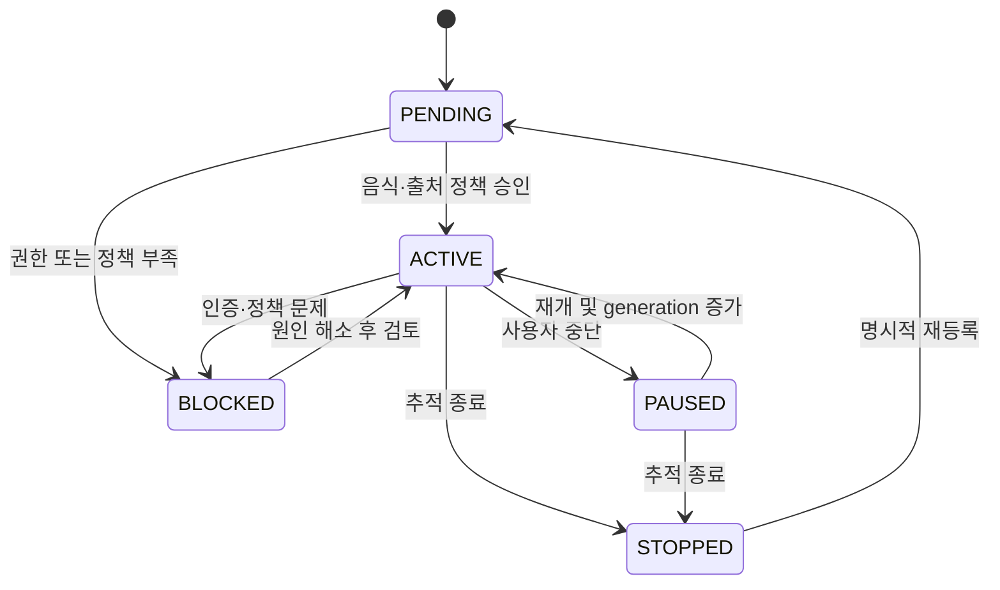

# 탐지 → 개체 식별 → 추적 통합 설계안

구현 전 설계안이다. 현재 연결 상태와 근거는 [REPORT.md](REPORT.md), 저장 모델은 [ORACLE_MODEL.md](ORACLE_MODEL.md)를 참조한다.

## 단계별 계약

각 메시지는 `contract_version`, `event_id`, `origin(live_api/mock/user/legacy_unknown)`, `occurred_at(UTC)`, `trace_id`, `policy_version`을 포함한다. 원문은 허용된 증거 참조로 전달하고 인증정보는 메시지에 넣지 않는다. 아래 키는 논리 정의이며 실제 직렬화·길이·해시 알고리즘 버전은 구현 시 고정한다.

| 단계·책임 | 입력 → 출력 필드 | 멱등성·중복키 | 실패·재시도 |
| --- | --- | --- | --- |
| DISCOVERY: 허용된자료에서 단서 | source/run/item/snapshot/evidence reference → surface_text, entity_type, classification, rule_version/score, evidence_spans, observed_at | source+item+snapshot+extractor_version+surface span | 파싱실패는quality quarantine. FOOD없음은정상종료, 가짜후보생성 금지. YT추출은policy gate에서비활성 |
| CANDIDATE: 승인전업무단위 | 단서또는사용자 음식 → candidate_id, surface/normalized_text, scope, origin, evidence_refs, state | 단서키+normalizer_version. 사용자 등록은client request key | 자료부족은NEEDS_REVIEW. 후보반복은증거추가이며음식중복 생성아님 |
| ENTITY RESOLUTION | candidate+승인alias목록 → RESOLVED(food_id,decision_id,method,version) / NEEDS_REVIEW / REJECTED | candidate_id+resolution_version+decision_revision | exact alias외충돌은검토. fuzzy/embedding은top-k제시, 자동 확정안함. 재시도해도새food_id생성안함 |
| TRACKING TARGET | 승인food_id+source+account_scope+사용자/자동정책 → target_id,state,generation,interval,next_due | food_id+source+account_scope | 공급자/앱권한미확인BLOCKED, 예산부족은대기. 음식 유형아닌브랜드/매장등록거부 |
| QUERY PLANNER | target+승인alias+source capabilities+policy+budget → query_id/spec_hash, group→target map, due_slot, expected_cost, limits, effective_window | source+account_scope+canonical params+planner_version. 같은요청은여러target가공유 | alias없는경우대표명검토, 모호alias보류, 정책범위초과계획거부. 예산초과이월·우선순위조정 |
| SOURCE COLLECTOR | 계획+job_key+lease fence → run_id, API_CALL시도, envelope, next_cursor, coverage, errors | query spec+fixed window+due_slot+generation. 재시도는같은run아래새attempt | 예약commit후HTTP, retryable만백오프. 외부호출exactly-once를보장하지않고저장멱등성보장 |
| INGESTION/STAGING | envelope + origin/policy → 허용SOURCE_ITEM/snapshot/RUN_ITEM | source+external_key, item+hash+adapter_version, run+item | 스키마이상격리. 허용없는raw는버림. NAVER응답은메모리검증후반환하며DB저장 금지 |
| DQ/CORE | 스키마·시각·값검사+개체결정 → quality_result, search_match, confirmed mention, allowed metric | quality rule event key, match/mention/observation key | 부분 수집은정상완료와분리. 정책미승인파생정보생성차단. source별필드누락상태유지 |
| ANALYTICS | 확인된mention·관측·coverage → 출처/단위/context별일 집계 | food+source+metric+day+context+aggregation_version(+origin) | 실패는null, 정상관측0은0. 재집계는동일키치환·버전교체, raw관측불변 |

Source Envelope의 필수 필드는 `source_code, run_key, source_schema_version, adapter_version, observed_at, origin, request_context, coverage`다. 콘텐츠 형식은 `external_key,published_at?,provided_fields,field_states,payload_ref?,payload_hash`, 지표 형식은 `subject_key,metric_code,unit,provider_period,value_state,value,comparison_context_hash`로 분리한다. DataLab 결과는 지표 형식으로 메모리에서만 사용한다. 비밀키·토큰·원격 오류 URL은 request_context에 넣지 않는다.

## 후보 승인과 음식 관계

대기 후보는 `NEW → NEEDS_REVIEW → RESOLVED/REJECTED`로 진행한다. 승인된 정확 별칭과 모호함 없이 일치하고 정책상 허용된 경우에만 기존 음식에 자동 연결한다. **신규 음식 생성·모호한 별칭 등록·개체 병합은 초기 MVP에서 사람 승인**을 거치도록 설계한다.

검토자는 기존 음식 선택, 신규 음식 생성, 별칭 확정, 별도 파생 음식 생성, 관련 음식 연결, 비음식 거절 중 하나를 선택하고 근거를 남긴다. `두쫀쿠/두바이 쫀득 쿠키`는 승인된 정확 별칭의 예시다. `짭쫀쿠`는 별도 후보로 검토한다. 공동 출현과 문자열 유사성은 EXACT_ALIAS를 검토할 단서로만 사용한다.

음식명과 브랜드·매장명은 분리한다. FOOD_BRAND 분류만으로 자동 음식 추적 대상을 만들지 않고 해당 브랜드의 실제 상품명을 별도 후보로 검토한다. 한 음식의 여러 별칭이 검색어를 만들어도 food_id는 같고, 한 콘텐츠에 등장하는 여러 음식은 각각의 mention으로 연결한다.

변경결정은ENTITY_CHANGE_EVENT를남긴다. 잘못된 병합은inverse event만으로기계적으로복구할수있는범위를기록하고, 이후추가된모호mention은수동검토한다. 변경전에쓰던query도불변 버전으로남긴다. 재해석된음식 집계는새resolution/aggregation버전으로재생성하고과거실제 API관측을수정하지않는다.

## 검색어 계획과 예산

| 출처 | 계획 규칙 | 비용·커버리지·중복 |
| --- | --- | --- |
| RSS | 출처고정geo=KR feed. 음식별target를RSS검색요청으로변환하지않음 | 한feed작업공유. 별칭당중복RSS호출금지. 현재30분주기유지가능 |
| Instagram | 승인된정확태그만, 공백제거결과도승인대상문자열로검토. ID해결과recent_media계획, account scope유지 | 7일고유태그예산과HTTP시도/페이지예산분리. 30/soft28현재규칙유지, 추가관련태그자동검색금지. 기본20페이지상한·limited기록 |
| YouTube | FOOD대상과광역discovery를분리. 신규사용자 음식도승인target에서tracking query생성하도록확장 | 별칭을합친검색 문법의정확도가미검증이므로무조건OR결합하지않음. 같은query/조건은공유하고video ID로저장중복방지. 내용추출은승인전비활성 |
| NAVER | 동일food의승인별칭을한group, 그룹간동일검색어중복차단. 초기5그룹×각5개. 전체batch구성과기간을context로고정 | 최대그룹수로배치, KST일100상한·provider월/RPS정보를별도통제. 다른batch ratio를공통순위로취급금지. 응답미저장 |

API일별quota와분석일자는별도다. YouTubequota는America/Los_Angeles와DST, NAVER는KST, 저장순간은UTC, 음식일 집계는KST다. RSS pubDate는원timezone을해석해UTC로변환한다. 게시 시각·처음발견시각·수집 시각·공급자통계기간을서로대체하지않는다.

일반작업은만료/갱신기한이임박한자료, 오래대기한추적 대상, 발굴대상순의우선순위정책을제안하되구체가중치는확정하지않는다. 실제계정 한도는provider콘솔이최종기준이다. 로컬예약은실제원격차감량이아니며다른앱과키공유를추적하지못하면상태에그한계를표시한다.

## 상태·중단·재개·정정

PAUSED/STOPPED는새작업생성을막는다. 이미전송된HTTP를취소했다고가정하지않고결과반영전target.generation과lease.generation을검사한다. 중단후도착한응답은정책에따라허용된운영이력만남기거나격리하며자동재활성화하지않는다. source별target와query매핑을분리하므로공유query의다른음식이계속활성이어도중단한음식 집계에응답을넣지않는다.

이름/별칭/주기변경은target revision과새query버전으로반영한다. 신규도래시각을원자적으로갱신하고이전outbox작업을generation으로무효화한다. **로컬재처리**는허용된snapshot으로정규화/해결/집계를새버전으로수행하며API예산0이다. **API재수집**은별도job purpose·명시범위·quota예약으로다룬다. 수집기오류정정으로임의의과거측정값을새로만들지않는다.

## 예외·실패 복구

| 상황 | 제안 동작 |
| --- | --- |
| FOOD후보0 | 발견실행성공+후보0. 사용자 음식 등록은같은resolution/target경로로진입. 후보임의추가금지 |
| 401/403·토큰 만료 | 해당출처/계정BLOCKED, 반복자동시도차단. 마지막성공과실패시각분리 |
| 429/Retry-After | provider대기시간전체존중, jitter있는재예약. 현재IG30초cap은짧은대기가되지않도록수정검토 |
| quota부족 | 새HTTP전예약거절, due연기. 실패/미관측으로표시하고0집계안함 |
| 5xx·timeout | 같은논리run내새attempt, 제한횟수백오프. 외부성공여부불명일수있음을기록 |
| 페이징중실패 | 이미검증된콘텐츠만멱등저장하고PARTIAL. fixed window/cursor/coverage유지. 완료로표시금지 |
| 응답스키마변경 | adapter검증실패→격리·경보, checkpoint전진금지. 허용되지않는원문은저장하지않고형태오류코드만남김 |
| 콘텐츠삭제/비공개 | 해당source item·snapshot·match·허용파생물을정책대로삭제/비활성화. downstream집계무효화 |
| lease만료·중복worker | owner/fence세대검증으로늦은commit차단. 외부중복 호출가능성은예산에반영 |
| HTTP성공후DB실패 | 상태uncertain, 원시값의무손실을허가된staging/outbox로복구. 재시도는같은item/observation key. provider응답영구저장 금지출처는저장복구를보장하지않음 |
| 잘못된alias·병합 | 매핑 이력기반분리·검토, 관련target/query/집계다시계획. 정책만료원문은복원불가상태 |
| 이관중두DB불일치 | outbox재전달·대조로복구, 수집API재호출로메우지않음 |

## 자동화·검증 시나리오

1. RSS에FOOD가없다. 사용자가두쫀쿠를등록하고검토자가기존food또는신규food를확정한다. 출처별target를선택하고허용정책을검사한다. 이단계는원RSS분류를변경하지않는다.
2. planner가IG승인태그, NAVER별칭group, YTtracking검색을각출처의문법으로만든다. 동일 요청은query와quota예약을공유한다. RSS는기존발굴feed그대로다.
3. Mock수집으로같은게시물/영상이두별칭검색에나오게한다. SOURCE_ITEM은1, 검색 근거는복수, 확인된음식별고유 콘텐츠집계는1이어야한다. YT내용미검증자료는mention0이어야한다.
4. NAVER Mock지수는현재화면응답으로만반환하고DB·파일·브라우저영구저장소에는없어야한다. YT분석허가없으면음식 추출·파생지표행0이어야한다.
5. 새RSS후보가정확 별칭과일치하면동일food의기존target를재사용한다. 짭쫀쿠는별도 검토로남는다. 브랜드후보는음식target로승격되지않는다.
6. 중간에pause·재개·credential오류·quota소진·부분페이지·worker중단·DB실패를주입해늦은commit차단과멱등복구를검증한다. 실패구간은null, 정상관측0은0이어야한다.
7. 병합/분리이벤트후관련집계만새버전으로계산한다. 정책TTL이끝난raw가재처리되거나outbox/백업으로부활하면안된다.

이일곱경로를임시 DB/격리Oracle테스트로통과한뒤에만실제연동시험계획을작성한다. 실제 호출시험은출처별목적·최대요청/재시도·페이지수·quota영향을사전에명시하고별도 범위로진행한다. 이번 감사에서는해당실제 호출시험을실행하지않았다.
