# 데이터베이스 변천 감사 — SQLite에서 Oracle `MZ_APP` 운영 전환까지

작성 2026-11-13, 읽기 전용 감사. 코드·DB·설정·기존 파일 변경 없음, 커밋 없음, 외부 API·서버·수집기·테스트 실행 없음.
근거: Git 이력(`main` HEAD `363ea0f`), 소스 코드, `reports/` 보고서, SQLite 파일 읽기 전용 조회(`mode=ro`), **실제 Oracle `MZ_APP` 읽기 전용 SELECT**(2026-11-13 20:47 KST 무렵, python-oracledb Thin, DML·DDL·commit 없음).
자격 증명 값은 읽거나 출력하지 않았다(env 파일은 변수 **이름**만 확인, 접속은 메모리 안에서만 사용).

> 감사 부수효과 고지: WAL 모드 SQLite를 `mode=ro`로 열면 SQLite가 `-shm` 공유 메모리 파일을 갱신할 수 있다. `data/ops-prod/production-source-v11.sqlite3-shm`의 수정 시각이 감사 시각(2026-11-13 20:46)으로 바뀐 것은 이 감사의 읽기 때문으로 보인다. 본 파일(`.sqlite3`)의 SHA-256·행 수는 아래와 같이 보고서 값과 동일하다.

---

## 1. 요약 타임라인

| 날짜 | 단계 | 내용 | 근거(커밋/보고서) |
| --- | --- | --- | --- |
| ~2026-10-27 이전 | 초기 SQLite MVP | 서비스 생성자가 DDL을 실행하던 출처별 SQLite 저장(RSS·Instagram·YouTube·NAVER) 30개 테이블. 운영 DB `data/trends.sqlite3`는 이 시기 형태 그대로 **v0(마이그레이션 이력 없음)** | 저장소 최초 커밋 `97b3c35`(2026-10-27) 이전 이력은 Git에 없음 → 그 이전 개발 과정은 **미확인** |
| 2026-10-26 | 통합 감사·Oracle 설계 | Oracle 목표 모델 설계(실행 DDL 아님), 단계적 이관 권고 | `reports/integrated-audit-2026-10-26/REPORT.md` 7절, `ORACLE_MODEL.md` |
| 2026-10-27 | 명시적 마이그레이션 도입 | `migrations.py`(v1·v2) — 생성자 DDL 제거, `--migrate`로만 스키마 변경 | `97b3c35` |
| 2026-10-27~28 | SQLite v3~v10 | 음식 개체, 추적 대상, 질의 계획, 실행, 스테이징, 음식 관측 모델 | 3장 표 |
| 2026-11-02 | B6/B7 + v11 | Oracle 대상 스키마 명세(`target_schema.py`), 저장소 추상화, 이관(B7), Shadow(v11 트리거), G-OPS-0 개발 Oracle(`MZ_TEST`) 구축 | `5303b61`, `81fd1cd`, `18035ba`, `development-b6-b7`, `development-g-ops-0` |
| 2026-11-03~05 | Oracle Runtime | 실행·적재·관측·계획·슬롯·소유권·예산을 Oracle에서 직접 쓰는 런타임, 대상 스키마 v2→v10 | `e6867c5`~`3b8c7cb` |
| 2026-11-05 | 전환 준비 | 격리 사본 리허설(`cutover.py`), 역방향 복구(`reverse_recovery.py`), 절차서 | `1aeabe3`, `5af42a3`, `CUTOVER_RUNBOOK.md` |
| **2026-11-08 00:37~00:45 KST** | **운영 전환** | 백업 → v11 사본 → `MZ_APP` 적재 15,671행 → 대조 consistent → `--backend oracle-production` 기동 → 실제 API 7회 파일럿 | `dea4b33`, `9307d16`, `363ea0f`, `development-oracle-production-cutover-2026-11-07/` |
| 2026-11-13(감사 시점) | 현황 | `MZ_APP` 52개 테이블, 전환 직후 최종 점검(`final-verify.json`)과 행 수 **완전 일치**, 이후 추가 쓰기 없음 | 6장 |

---

## 2. 초기 DBMS: SQLite (v0, 30개 테이블)

현재 `food_trends/migration_definitions.py`의 `BASE_SQL`(v1 내용)과 `LEGACY_ADDITIONS`가 초기 스키마를 그대로 보존한다(모듈 docstring: "Legacy additive schema, executed only by the explicit migration runner"). 운영 원본 `data/trends.sqlite3`는 30개 테이블·7,701행·SHA-256 `38b880f5…`(감사 시 재계산, 보고서와 동일)·`integrity ok`·FK 오류 0.

| 영역(원래 모듈) | 테이블 | 키·무결성 | v0 행 수 |
| --- | --- | --- | ---: |
| RSS (`storage.py`) | `runs`(회차, `raw_response` BLOB), `items`, `observations`, `candidates`, `classification_history` | `items.id` PK + `source_id UNIQUE`; `observations` PK(run_id,item_id) FK→runs/items; `candidates.item_id` PK·FK→items(1:1 분류 결과) | runs 95, items 370, observations 900, candidates 370, history 251 |
| Instagram (`instagram_storage.py`) | `instagram_hashtags`, `_media`, `_hashtag_media`, `_runs`, `_searches`, `_metrics`, `_state`, `_leases`, `_caption_analysis`, `_caption_tags`, `_analysis_observations`, `_observation_tags`, `_candidate_hashtags` | `instagram_media.id` TEXT PK(외부 ID), `hashtags UNIQUE(user_id,name)`, 다대다 `hashtag_media` PK(hashtag_id,media_id) | media 185, hashtag_media 185, runs 16, analysis_obs 700, observation_tags 2,386 |
| YouTube (`youtube_storage.py`) | `youtube_foods`, `_candidate_foods`, `_queries`, `_videos`, `_matches`, `_calls`, `_state`, `_runs`, `_video_provenance` | `videos.video_id` PK + `expires_at` 인덱스(만료형 저장), `matches` PK(query_id,video_id) `ON DELETE CASCADE`, `queries UNIQUE(query,mode)` | videos 431, matches 473, calls 38, provenance 431 |
| NAVER (`naver_service.py`) | `naver_targets`, `naver_calls`, `naver_guards` | 호출 메타데이터만 저장(값·본문 미저장, 정책) | calls 10, guards 5 |

초기 모델의 연결 방식: **콘텐츠 = 출처별 테이블**, **후보 = RSS `items`에 1:1로 붙은 `candidates`**(정수 ID), 음식 개체·별칭 개념은 없었고 YouTube는 `youtube_foods`/`youtube_candidate_foods`라는 출처 전용 매핑을 따로 가졌다. 통합 감사(2026-10-26) F01은 `storage.py`의 `INSERT OR REPLACE`와 YouTube `ON DELETE CASCADE` 조합이 후보 재저장 시 연결을 지우는 결함을 지적했고(F11: CHECK·버전 통제 약함), 이것이 명시적 마이그레이션과 공통 모델 도입의 직접 동기가 됐다.

---

## 3. 명시적 마이그레이션 시스템 (SQLite v1 → v11)

`food_trends/migrations.py`(`LATEST_VERSION = 11`) 설계:
- 생성자는 DDL을 실행하지 않는다. `Storage.__init__`은 `require_current()`만 호출하고, 버전이 다르면 `MigrationRequired`("Back up first, then run python -m food_trends --migrate").
- `migrate()`: 파일이 없으면 생성 거부(`create=True`/`--create-database`만 허용), 다운그레이드 거부, `BEGIN IMMEDIATE` 하나의 트랜잭션으로 미적용 버전만 순서대로 적용 → `schema_migrations(version PK, name, applied_at)` 기록 → `PRAGMA foreign_key_check` 실패 시 전체 롤백.
- `schema_version()`은 이력이 1..N 연속인지 검사(비연속이면 거부).

| 버전 | 이름 | 추가 내용 | 도입 커밋 |
| --- | --- | --- | --- |
| 1 | legacy_additive_schema | 위 30개 테이블 + 누락 열 보강(`candidates.entity_type/rule_score/evidence_news…`, `runs.food_count…`, `instagram_media.caption…`, `youtube_calls.origin/run_id…`) | `97b3c35` 10-27 |
| 2 | source_contract_metadata | `origin`(기본 `legacy_unknown`)·`contract_json`(`json_valid` CHECK) 열을 runs/instagram_runs/instagram_media/naver_calls/observations/… 에 추가 | `97b3c35` 10-27 |
| 3 | reviewed_food_entities | `food_commands`, `food_entities`, `food_aliases`(활성 별칭 부분 UNIQUE), `food_relations`(순환 방지 트리거), `food_candidates`, `food_events`(UPDATE/DELETE 금지 트리거=추가 전용) | `510bf75` 10-27 |
| 4 | food_tracking_targets | `tracking_commands`, `tracking_targets`(UNIQUE(food_id,source_id,account_scope)), `tracking_events`(추가 전용), `tracking_slots` | `6cece7c` 10-27 |
| 5 | source_query_planner | `planner_queries/plans/query_targets/plan_targets/commands`, `quota_reservations/charges/events` | `9839e80` 10-27 |
| 6 | reliable_tracking_execution | `execution_jobs/mappings/outbox/leases/runs/calls/checkpoints/results/blocks` | `cca7ee7` 10-27 |
| 7 | tracking_collector_ownership | `execution_source_ownership`, `execution_item_receipts` | `59376f2` 10-28 |
| 8 | execution_result_coverage | `execution_runs.result_coverage`(COMPLETE/PARTIAL/LIMITED/NONE), `committed_pages` 열 | `ea08fe9` 10-28 |
| 9 | common_ingestion_staging | `ingest_runs`, `source_items`(UNIQUE(source_code,external_key)), `item_snapshots`(UNIQUE(item_key,payload_hash,adapter_version)), `run_items`, `quality_results` | `051e310` 10-28 |
| 10 | food_observation_model | `item_query_matches`, `food_mentions`, `metric_observations`, `entity_change_effects`, `aggregate_invalidations` | `594f47b` 10-28 |
| 11 | oracle_shadow_capture | `shadow_settings`, `shadow_outbox` + 캡처 대상 테이블별 AFTER INSERT/UPDATE/DELETE 트리거 | `18035ba` 11-02 |

참고: `git log -- food_trends/migration_definitions.py`는 `97b3c35` 한 건뿐이다(레거시 정의는 이후 바뀌지 않음). 버전 3~11은 각 `*_schema.py`에 있고 `migrations.py` 이력으로 도입 시점을 확인했다.

v11 사본 실측(`data/ops-prod/production-source-v11.sqlite3`): 72개 테이블(+`sqlite_sequence`)·21,777행·트리거 117개·`application_id`=격리 표시 값·`schema_migrations` 11행(모두 2026-11-07T15:38:17Z 적용)·integrity ok·FK 오류 0. 원래 30개 테이블 행 수는 v0와 동일하고, 사본 안에서 생성된 행은 `ingest_runs 97, source_items 555, item_snapshots 840, run_items 1085, quality_results 10402, item_query_matches 185, metric_observations 900, shadow_settings 1`. `food_*`/`tracking_*`/`execution_*`/`planner_*`/`quota_*`는 전부 0(v0 원본에 음식 개체 자체가 없었음).

---

## 4. Oracle 도입: 왜, 언제, 어떻게

### 4.1 동기와 설계 (2026-10-26)
`integrated-audit-2026-10-26/REPORT.md` 7절: "출처별 수집기를 유지하면서 repository 계층을 추가해 Oracle로 **단계적 이관**". 개발안은 Oracle AI Database 26ai Free + python-oracledb **Thin**(Oracle Client 불필요). SQLite 전용 문법(`INSERT OR REPLACE`, `ON CONFLICT`, `?`, PRAGMA)은 이식 불가하므로 저장소 계층 분리, 즉시 이중 쓰기는 원자성이 없으므로 outbox·멱등성 우선, 6단계 순서(계약·P0 수정 → 별도 스키마·테스트 → 스냅샷 이관·행 대조 → shadow → 단일 Writer 전환 → 되돌리기 검증). `ORACLE_MODEL.md`는 자료형 규칙(TS=`TIMESTAMP(6) WITH TIME ZONE` UTC, JSON=`CLOB CHECK IS JSON`, Oracle의 `''`=NULL 처리, 모든 FK 선두 열 인덱스)을 정했다.

### 4.2 하나의 명세 → 두 방언 DDL (B6, 2026-11-02)
- `target_schema.py`: `Table`/`Column` 데이터클래스로 51개 테이블을 한 번 정의, `ddl('oracle')`/`ddl('sqlite')`가 각각 DDL 생성. 종류별 매핑 예: `id`→`VARCHAR2(128 CHAR)`/`TEXT`, `ts`→`TIMESTAMP(6) WITH TIME ZONE`/`TEXT`, `json`→`CLOB`+`IS JSON`/`TEXT`+`json_valid`. FK는 `DEFERRABLE INITIALLY DEFERRED`, 제약 이름은 SHA-256 기반 30자 이내 고정 이름, 부분 UNIQUE는 Oracle에서 함수 기반 `CASE WHEN` 인덱스로 변환, 예약어 회피(`mode`→`exec_mode`).
- `TARGET_SCHEMA_VERSION = 10`. 대상 스키마 변경 이력(주석): v1 기본(11-02) → v2 실행 런타임 상태 → v3 계획 이력 → v4 추적 슬롯 → v5 `runtime_ownership` → v6 예산(`quota_usage_ledger`, `quota_accounts`) → v7 추적 명령 → v8 `rss_runs`/`rss_observations` → v9 `payload_text` → v10 `release_requested_at`·`writer_transfer_events`(11-05 `3b8c7cb`).
- `target_db.py`: Oracle 어댑터(Thin, 드라이버 지연 import, 없으면 SQLite로 대체하지 않고 실패)와 SQLite 대역. 변환·검증이 방언 독립이라 대역도 Oracle이 거부할 값을 거부.
- `target_repository.py`: 이식 가능한 SQL만(named bind, 평범한 INSERT/UPDATE/SELECT), 논리키 조회 후 삽입·UNIQUE 경합 시 재조회 갱신, 불변 열 보호. `migrate()`만 스키마를 만들고 `target_schema_migrations(version, checksum, applied_at)`에 명세 체크섬을 기록, 불일치 시 `target_schema_checksum_mismatch`.
- `ORACLE_SCHEMA.md`/`oracle-target-ddl-v1.sql`(73문)은 당시 "실제 Oracle에서 실행되지 않았다(NOT_VERIFIED)"로 기록 — 같은 날 G-OPS-0에서 실제 검증으로 해소.

### 4.3 개발 Oracle (G-OPS-0, 2026-11-02)
WSL Ubuntu 24.04 + Podman 4.9.3, 공식 이미지, 서버 **23.26.3.0.0**(26ai Free), PDB `FREEPDB1`, AL32UTF8, `127.0.0.1:1521`, 이름 있는 볼륨 `mz-oracle-data`. 테스트 스키마 `MZ_TEST`(CREATE SESSION·CREATE TABLE만). 보존 스냅샷 복제본으로 v0→v11→`MZ_TEST` 이관 실증. STORAGE-1(11-02)은 모든 저장 위치가 D 드라이브에 있음을 확인(DB 경로 기본값 `data/trends.sqlite3`, 이동 불필요).

### 4.4 이관·동기화·복구 모듈
| 모듈 | 역할 |
| --- | --- |
| `target_migration.py`(B7) | 읽기 전용 export → 정책/TTL 필터 → 매핑 → 변환 → 검증 → 배치 적재 → 대조. 만료값은 재계산 없이 복사, 만료 근거는 내용 없는 `EXPIRED` 묘비로. `legacy_key_map`·`migration_batches`·`migration_rejections`로 재실행 멱등 |
| `shadow.py` | SQLite가 SoR일 때 v11 트리거가 쌓은 변경을 Oracle에 멱등 전달·비교·복구. SHADOW 소유권 lease 필요, 기본 비활성 |
| `runtime_ownership.py` | 대상 DB 한 개에 쓰기 소유 모드(IDLE/SHADOW/RUNTIME_TEST/RUNTIME_PRODUCTION)+epoch, 모든 쓰기 트랜잭션이 `LOCK TABLE runtime_ownership IN SHARE MODE`로 검사 → 프로세스 메모리가 아닌 DB가 배타성 강제 |
| `cutover.py` | 운영 DB를 `mode=ro`·`query_only`로 열어 SQLite backup API로 복사, 사본에 `application_id` 표시, 모든 변경은 사본에서만 |
| `reverse_recovery.py` | Oracle → SQLite v11 역방향 복구(롤백 경로). 소유권 IDLE·미완료 작업 0일 때만 시작, 배타 SHADOW lease 보유 |
| `production_access.py` | 운영 접근 조건: 접속 계정이 선언된 운영 스키마(`*_TEST`·시스템·DBA 계정 거부) + 승인 기록 JSON(스키마·승인자·시각·게이트 근거) |
| `runtime_storage.py` | `sqlite` / `oracle-test` / `oracle-production` 세 모드, 추론하지 않고 명시 선택 |

---

## 5. 운영 전환 실행 (2026-11-08 00:37~00:45 KST)

근거: `development-oracle-production-cutover-2026-11-07/MIGRATION_REPORT.md`, `backup-verification.json`, `migration-verification.json`, `FINAL_ACCEPTANCE.md`, `CUTOVER_RUNBOOK.md`(G-OPS-1~6 순서).

1. **백업(G-OPS-1)** — 원본을 `mode=ro`·`query_only`로 열어 SQLite backup API로 `data/ops-backup-20261107T153742Z/trends-v0-backup.sqlite3`(9,273,344B, SHA-256 `e211a8c1…`) 생성. 파일 해시는 페이지 배치 때문에 원본과 다르지만 **모든 테이블·열·행 다이제스트 동일**, 30개 테이블·7,701행, integrity ok, FK 0, 새 파일로 **복원 시험**까지 동일. 원본 SHA·크기·mtime·WAL 크기 불변 확인. (감사 재측정: 백업 30개·7,701행, SHA 접두 `e211a8c1` 일치.)
2. **Writer 정지(G-OPS-2)** — 이미 정지 상태.
3. **SQLite v0→v11(G-OPS-3), 사본에서만** — `--isolate-database data/ops-prod/production-source-v11.sqlite3`. 원래 30개 테이블 변경 0, B4/B5 스테이징 생성(RSS 회차 95 + 출처 불명 논리 회차 2 = 97).
4. **운영 스키마(G-OPS-6)** — `MZ_APP` 생성(컨테이너 내 OS 인증 SYSDBA로 1회), `--target-migrate oracle`로 대상 스키마 v10.
5. **적재** — `--target-load oracle --isolated-database …v11.sqlite3`. 1차 15,671행, 2차 재실행 15,671행(완료 배치 재사용, 새 쓰기 0 = 멱등).
6. **대조** — `migration-verification.json`: `target_tables 51`, `target_rows 16,699`, `keys_clean true`, 자연키 중복 0, 키 형식 오류 0, B7 배치 `COMPLETED`, **B8 API 동등성**(17요청 × origin 2종, 불일치 0), 15개 범주(`food_identity`…`aggregate_invalidations`) 전부 `true`. 보고서: missing·extra·changed 0, FK 오류·미해결 원문 참조·정책 위반·만료 복원 0.
7. **런타임 전환** — `--backend oracle-production`(관리 서버), `food_trends.app_api --store oracle-production`(앱 API, 읽기 전용) — `scripts/ops/start-backend.ps1`. 소유 모드 `RUNTIME_PRODUCTION`.
8. **실제 API 파일럿** — 사용자 승인 registry, 상한(RSS 1·IG 5·YT 2·NAVER 1) 안에서 RSS 1·Instagram 3·YouTube 2·NAVER 1 = **7회**, 모두 HTTP 200(`live-pilot.json`, `LIVE_VERIFICATION.md`). 음식 `두쫀쿠` 승인, 추적 대상 3개 등록, 검증용 후보 1건 거절.
9. **영속성** — `podman stop -t 120` 후 재시작, `persistence-before.json` = `persistence-after.json`(행 수 동일), `final-verify.json`(11-08 09:26Z) 실패 0.

### 이관 범위에서 제외된 것(설계상)
`cutover.OTHER_TABLES`의 24개 테이블: 수집기 지역 상태·lease·잠금(`instagram_leases`, `naver_guards`, `youtube_state`…), 출처별 원시 호출 기록(`naver_calls`, `youtube_calls`, `instagram_runs`…), 태그 집계, 레거시 매핑(`youtube_foods`, `naver_targets`…), Shadow 캡처, SQLite 이력. `runs.raw_response`·`observations`는 `ingest_runs`/`run_items`/`source_contents`로 대체 표현. 음식·FOOD_ID 이관은 0건(원본에 없음, 임의 생성 안 함).

---

## 6. 실제 Oracle `MZ_APP` 현황 (감사 시 읽기 전용 조회)

접속 확인: `user`=`MZ_APP`, 컨테이너 `FREEPDB1`, 버전 23.26.3.0.0. 시스템 권한 **CREATE SESSION, CREATE TABLE만**, 롤 없음(보고서와 일치). 객체: TABLE 52, INDEX 162(제약 외 명시 인덱스 90), LOB 34. 제약: PK 52, UNIQUE 20, FK 57, CHECK 512 — **비활성·미검증 제약 0**. `target_schema_migrations` = 1행(version **10**, 2026-11-07 15:38:27Z). `migration_batches` 29건 전부 `COMPLETED`, `migration_rejections` 0, `runtime_ownership` = (`TARGET`, `RUNTIME_PRODUCTION`, epoch 23).

### 6.1 행 수 비교 (SQLite 원천 → 이관 직후 → 최종 점검 → 현재)

| 테이블 | SQLite v11 사본 | 이관 직후 `migration-verification` | `final-verify` 11-08 | **현재 MZ_APP** | 전환 후 증감·원인 |
| --- | ---: | ---: | ---: | ---: | --- |
| source_contents | (RSS items 370+YT 431+IG 185) | 986 | 1,086 | **1,086** | +100 (RSS 10, IG 40, YT 50 — 파일럿) |
| source_items | 555 | 555 | 655 | **655** | +100 |
| item_snapshots | 840 | 840 | 940 | **940** | +100 |
| run_items | 1,085 | 1,085 | — | **1,185** | +100 |
| ingest_runs | 97 | 97 | 101 | **101** | +4 (출처별 live_api 회차 1개씩) |
| quality_results | 10,402 | 10,402 | 11,106 | **11,106** | +704 |
| metric_observations | 900 | 900 | 911 | **911** | +11 |
| item_query_matches | 185 | 185 | — | **275** | +90 |
| rss_classifications | candidates 370 | 370 | — | **380** | +10 (RSS 신규 10건) |
| rss_classification_history | 251 | 251 | — | **251** | 0 |
| legacy_key_map / migration_batches | — | 991 / 29 | — | **991 / 29** | 0 (이관 기록 불변) |
| food_entities / food_aliases / food_candidates | 0 / 0 / 0 | 0 | 1 / 1 / 2 | **1 / 1 / 2** | 운영 승인 1(두쫀쿠), 후보 RESOLVED 1·REJECTED 1 |
| food_mentions | 0 | 0 | 143 | **143** | 이관된 IG 게시물 + 신규에서 두쫀쿠 언급 |
| tracking_targets / execution_jobs / execution_calls | 0 | 0 | 3 / 3 / 6 | **3 / 3 / 6** | 파일럿 (jobs: IG LIMITED, YT LIMITED, NAVER SUCCEEDED) |
| rss_runs | — | — | 1 | **1** | 파일럿 RSS 1회 |
| quota_accounts / runtime_participants | — | 3 / 4 | — | **4 / 12** | 계정 1 추가, 프로세스 기동 기록 누적 |

출처·origin별(현재): `ingest_runs` = RSS legacy_unknown 95 + live_api 1, IG legacy 1 + live 1, YouTube legacy 1 + live 1, NAVER live 1. `source_contents` = RSS legacy 370 + live 10, IG legacy 185 + live 40, YouTube live_api 481(이관 431 + 신규 50).

**최신 시각**: `metric_observations.observed_at` 최대 2026-11-07 23:26:04, `food_mentions.created_at` 23:26:19, `execution_runs.observed_at` 23:26:15, `rss_runs.started_at` 23:26:02(모두 UTC) → **파일럿 이후 새 데이터 쓰기 없음**. 현재 행 수는 `final-verify.json`/`persistence-after.json`의 14개 행 수 항목과 **전부 일치**한다. 지속 자동 수집이 `CONFIGURED_NOT_ENABLED`라는 보고서 내용과 일치.

### 6.2 현재 운영 DB와 원본 보존
- **현재 운영 SoR: Oracle `MZ_APP`**(관리 서버 `--backend oracle-production`, 앱 API `--store oracle-production`).
- `data/trends.sqlite3`: **v0 그대로 보존**(30개 테이블, 7,701행, SHA-256 `38b880f5…`, `schema_migrations` 없음). 현재 코드는 v0에서 `MigrationRequired`로 기동을 거부하므로 레거시 서버가 실수로 쓸 수 없다(`FINAL_ACCEPTANCE`의 "레거시 서버 시작 불가").
- `data/ops-prod/production-source-v11.sqlite3`: 이관 원천·롤백 기준(역방향 복구 지문 기준선).
- `data/ops-backup-20261107T153742Z/trends-v0-backup.sqlite3`: 검증된 v0 백업.

---

## 7. 백엔드 연결·쿼리 방식의 변화

| 구분 | 이전 | 현재 |
| --- | --- | --- |
| 드라이버 | `sqlite3` 직접, 서비스별 SQL | python-oracledb Thin(`target_db.py`), 포터블 SQL·named bind(`target_repository.py`) |
| 선택 | `DATABASE_PATH`(기본 `data/trends.sqlite3`) | CLI `--backend {sqlite, oracle-test, oracle-production}`(기본 `sqlite`), 앱 API `--store` — 추론하지 않음 |
| 업서트 | `INSERT OR REPLACE`/`ON CONFLICT` | 논리키 조회 → INSERT → `ORA-00001` 시 재조회·UPDATE |
| 동시성 | SQLite 파일 잠금 | `runtime_ownership` SHARE/EXCLUSIVE 테이블 잠금 + lease·epoch |
| 스키마 변경 | `--migrate`(SQLite v1~11) | `--target-migrate oracle`(대상 v10, 체크섬) |

환경 파일(변수 이름만 확인, 값 미열람):
- `data/oracle-dev/oracle-test.env` → **`MZ_TEST`(개발·회귀 테스트, 매번 초기화)**: `ORACLE_TEST_DSN`, `ORACLE_TEST_USER`, `ORACLE_TEST_PASSWORD`, `ORACLE_TEST_ENVIRONMENT`, `ORACLE_TEST_ALLOW_RESET`. (`container.env`: `ORACLE_PWD`)
- `data/oracle-prod/oracle-prod.env` → **`MZ_APP`(운영)**: `ORACLE_DSN`, `ORACLE_USER`, `ORACLE_PASSWORD`, `ORACLE_ENVIRONMENT`, `ORACLE_ALLOW_PRODUCTION`, `ORACLE_PRODUCTION_SCHEMA`, `ORACLE_PRODUCTION_APPROVAL`(→ `data/oracle-prod/production-approval.json`, 키: schema·approved_by·approved_at·gates).
- 분리 장치: 테스트 초기화는 `*_TEST`이면서 운영 스키마가 아닌 계정만, 운영 접근은 `*_TEST`·DBA 계정 거부, 테스트 라벨로 운영 스키마를 열면 `oracle_test_schema_required`. 두 스키마는 같은 Oracle 인스턴스(FREEPDB1)의 별도 계정이다.

---

## 8. 무결성 검증 근거 정리

| 검증 | 방법 | 결과 | 감사 재확인 |
| --- | --- | --- | --- |
| 원본 불변 | SHA·크기·mtime·WAL·테이블 비교 | 불변 | SHA `38b880f5…` 재계산 일치, v0·7,701행 |
| 백업 동일성 | 테이블별 전체 행 다이제스트 + 복원 시험 | 동일 | 30개·7,701행 일치 |
| 사본 마이그레이션 | integrity·FK·원래 30개 테이블 변경 0 | ok | integrity ok, FK 0, 72개·21,777행 일치 |
| 적재 대조 | missing/extra/changed, 해시·NULL, FK 고아, 정책 위반 | 모두 0, `consistent` | 이관분 테이블 행 수 = 사본(전환 후 증가분은 파일럿으로 설명됨) |
| 멱등성 | 2차 적재 | 새 쓰기 0 | `migration_batches` 29 COMPLETED, rejections 0 |
| 의미 동등성 | B8 API 17요청×2 origin, 15개 범주 비교 | 불일치 0 | 미재실행(테스트·서버 실행 금지) |
| 제약 | Oracle 제약 | — | FK 57·PK 52·UQ 20·CHECK 512 전부 ENABLED/VALIDATED |
| 영속성 | 재시작 전후 비교 | 동일 | 현재 = final-verify |

---

## 9. 보고서와의 불일치·주의 사항

1. **테이블 수 51 vs 52**: `migration-verification.json`의 `target_tables 51`은 명세(`TABLES`) 기준이며 실제 스키마에는 `target_schema_migrations`가 더해져 52개다. 모순은 아니고 집계 기준 차이.
2. **"대상 스키마 v10, 107개 객체"**(MIGRATION_REPORT 4절): 현재 `user_objects`는 TABLE 52 + INDEX 162 + LOB 34. 107이 무엇을 셌는지(생성 DDL 문 수로 추정)는 **미확인**.
3. **`target_rows 16,699` vs "적재 행 15,671"**: 차이 1,028 = 표의 "적재 기록(legacy_key_map 991, migration_batches 29)·소유권·사용량 계정"(991+29+1+4+3)과 정확히 일치 — 모순 아님.
4. `persistence-after.json`/`final-verify.json`의 음식 이름이 `"������"`로 저장돼 있다(한글 인코딩 손상, 증거 파일 표기 문제). DB 값 자체는 이번 감사에서 조회하지 않았다(**미확인**).
5. `ORACLE_SCHEMA.md`의 "NOT_VERIFIED"는 작성 당시 상태이며 G-OPS-0 및 운영 전환으로 해소됨 — 오래된 문서만 읽으면 오해 소지.
6. Oracle에서 `food_candidates.source_item_key`와 `source_items.payload_ref`/`item_snapshots.payload_ref` → `source_contents`는 **FK가 없는 논리 참조**다(SQLite v3의 `food_candidates.source_item_id`는 `items(id)` FK였음). 만료·삭제 정책 때문에 의도된 설계로 보이나 DB 차원 참조 무결성은 없다.
7. Git 최초 커밋(`97b3c35`, 10-27)이 이미 v1·v2 마이그레이션과 14,241줄을 포함한다. 그 이전(생성자 DDL 시절) 개발 이력은 Git으로 **확인 불가**.
8. 남은 한계(보고서 명시, 감사와 일치): 지속 자동 수집 미활성, DML 전용 실행 계정 미분리(`MZ_APP`이 소유자 겸 실행 계정), 운영 API 루프백 전용, 백엔드 자동 시작 미구성.

---

## 10. 현재 ERD (실제 `MZ_APP` FK 조회 결과 기반)

FK는 `user_constraints`(type R) 57건을 그대로 옮겼다. 점선 표기(`..`)는 FK 없는 논리 참조.

```mermaid
erDiagram
    SOURCE_CONTENTS ||..o{ SOURCE_ITEMS : "payload_ref (논리)"
    SOURCE_ITEMS ||--o{ ITEM_SNAPSHOTS : item_key
    INGEST_RUNS ||--o{ RUN_ITEMS : ingest_run_id
    SOURCE_ITEMS ||--o{ RUN_ITEMS : item_key
    ITEM_SNAPSHOTS |o--o{ RUN_ITEMS : snapshot_id
    RUN_ITEMS ||--o{ ITEM_QUERY_MATCHES : "ingest_run_id,item_key"
    INGEST_RUNS ||--o{ QUALITY_RESULTS : ingest_run_id
    SOURCE_ITEMS |o--o{ QUALITY_RESULTS : item_key

    FOOD_ENTITIES ||--o{ FOOD_ALIASES : food_id
    FOOD_ENTITIES |o--o{ FOOD_ENTITIES : merged_into
    FOOD_ENTITIES ||--o{ FOOD_RELATIONS : "from/to_food_id"
    FOOD_ENTITIES |o--o{ FOOD_CANDIDATES : resolved_food_id
    FOOD_ALIASES |o--o{ FOOD_CANDIDATES : resolution_alias_id
    SOURCE_ITEMS |o..o{ FOOD_CANDIDATES : "source_item_key (논리)"
    FOOD_COMMANDS ||--o{ FOOD_EVENTS : request_key
    FOOD_EVENTS ||--o| ENTITY_CHANGE_EFFECTS : food_event_id

    FOOD_ENTITIES ||--o{ TRACKING_TARGETS : food_id
    FOOD_CANDIDATES |o--o{ TRACKING_TARGETS : candidate_id
    TRACKING_TARGETS ||--o{ PLANNER_QUERY_TARGETS : target_id
    PLANNER_QUERIES ||--o{ PLANNER_QUERY_TARGETS : query_id
    PLANNER_QUERIES ||--o{ PLANNER_PLANS : query_id
    PLANNER_PLANS ||--o{ QUOTA_RESERVATIONS : plan_id
    PLANNER_PLANS ||--o{ EXECUTION_JOBS : plan_id
    PLANNER_QUERIES ||--o{ EXECUTION_JOBS : query_id
    EXECUTION_JOBS ||--o{ EXECUTION_CALLS : job_id
    QUOTA_RESERVATIONS ||--o{ EXECUTION_CALLS : reservation_id
    EXECUTION_JOBS ||--o{ EXECUTION_RUNS : job_id
    EXECUTION_RUNS ||--o{ EXECUTION_RESULTS : run_id
    TRACKING_TARGETS ||--o{ EXECUTION_RESULTS : target_id
    TRACKING_TARGETS ||--o{ TRACKING_SLOTS : target_id
    EXECUTION_JOBS |o--o{ INGEST_RUNS : job_id
    PLANNER_QUERIES |o--o{ INGEST_RUNS : query_id

    SOURCE_ITEMS ||--o{ FOOD_MENTIONS : item_key
    ITEM_SNAPSHOTS |o--o{ FOOD_MENTIONS : snapshot_id
    FOOD_ENTITIES ||--o{ FOOD_MENTIONS : food_id
    FOOD_ALIASES ||--o{ FOOD_MENTIONS : alias_id
    INGEST_RUNS ||--o{ METRIC_OBSERVATIONS : ingest_run_id
    FOOD_ENTITIES |o--o{ METRIC_OBSERVATIONS : food_id
    SOURCE_ITEMS |o--o{ METRIC_OBSERVATIONS : item_key
    FOOD_ENTITIES ||--o{ AGGREGATE_INVALIDATIONS : food_id

    SOURCE_CONTENTS {
        varchar payload_ref PK
        varchar item_key
        varchar source_code
        clob content_json
        tstz expires_at
    }
    SOURCE_ITEMS {
        varchar item_key PK
        varchar source_code UK
        varchar external_key UK
        varchar payload_ref
        varchar availability
    }
    ITEM_SNAPSHOTS {
        varchar snapshot_id PK
        varchar item_key FK
        varchar payload_hash UK
        varchar adapter_version UK
    }
    INGEST_RUNS {
        varchar ingest_run_id PK
        varchar source_code
        varchar run_ref
        varchar origin
        varchar job_id FK
    }
    RUN_ITEMS {
        varchar ingest_run_id PK
        varchar item_key PK
        varchar snapshot_id FK
        varchar quality_status
    }
    FOOD_ENTITIES {
        varchar food_id PK
        varchar canonical_name
        varchar status
        varchar merged_into FK
    }
    FOOD_ALIASES {
        varchar alias_id PK
        varchar food_id FK
        varchar normalized_form
        varchar status
    }
    FOOD_CANDIDATES {
        varchar candidate_id PK
        varchar candidate_key UK
        varchar source_item_key
        varchar status
        varchar resolved_food_id FK
    }
    TRACKING_TARGETS {
        varchar target_id PK
        varchar food_id FK
        varchar source_id
        varchar account_scope
        varchar candidate_id FK
    }
    EXECUTION_JOBS {
        varchar job_id PK
        varchar query_id FK
        varchar plan_id FK
        varchar source_id
        varchar status
    }
    FOOD_MENTIONS {
        varchar mention_id PK
        varchar mention_key UK
        varchar item_key FK
        varchar food_id FK
        varchar alias_id FK
    }
    METRIC_OBSERVATIONS {
        varchar observation_id PK
        varchar observation_key UK
        varchar ingest_run_id FK
        varchar food_id FK
        varchar item_key FK
    }
```

그 밖의 테이블: `execution_outbox/checkpoints/item_receipts/leases/mappings`(→`execution_jobs`), `planner_plan_targets`, `quota_charges`(→`quota_reservations`), `tracking_commands`→`tracking_events`, `rss_runs`→`rss_observations`, `rss_classifications`/`rss_classification_history`(RSS 분류, FK 없음), 운영 메타 `runtime_ownership`, `runtime_participants`, `quota_accounts`, `quota_usage_ledger`, `writer_transfer_events`, 이관 메타 `legacy_key_map`, `migration_batches`, `migration_rejections`, `shadow_applied`, `target_schema_migrations`.

### 데이터 흐름
1. **발굴**: RSS 수집 → `rss_runs`/`rss_observations` + `source_contents`(원문) + `source_items`(항목, `(source_code, external_key)` 유일) → `rss_classifications`(분류) → `food_candidates`(후보).
2. **음식 확정(사람 승인)**: `food_commands` → `food_events`(추가 전용 이력) → `food_entities` + `food_aliases`; 후보는 `RESOLVED`(→`resolved_food_id`/`resolution_alias_id`) 또는 `REJECTED`.
3. **추적 등록**: `tracking_targets`(음식×출처×계정, 유일) → `planner_queries`/`planner_query_targets` → `planner_plans` → `quota_reservations`(예산).
4. **실행**: `execution_jobs` → `execution_calls`(API 호출, 예약 연결) → `execution_runs` → `execution_results`(대상별 결과).
5. **적재·품질**: `ingest_runs`(job·query 연결) → `run_items`(회차×항목) → `item_snapshots`(내용 해시 버전) → `quality_results`, 검색 근거 `item_query_matches`.
6. **관측**: `food_mentions`(항목·스냅샷에서 별칭으로 찾은 음식 언급) + `metric_observations`(회차 단위 수치, 음식·항목 선택 연결) → 앱 API(B8)가 일별 지표(`OBSERVED`/`NOT_OBSERVED`/`EVIDENCE_EXPIRED`)로 제공.
