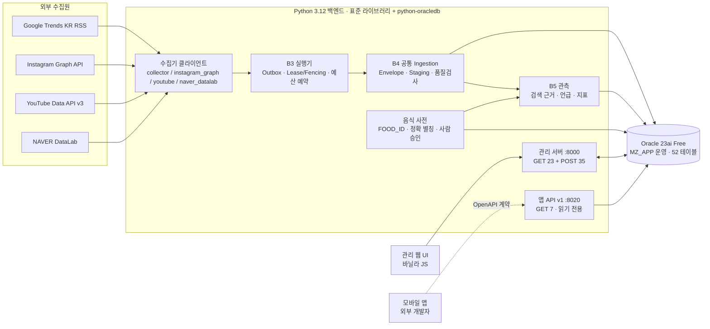
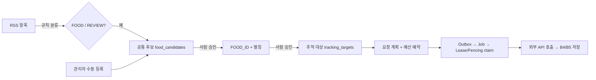

# MZFoodTraker 기술 발표 요약 — 어떻게 만들었고, 무엇을 완성했는가

감사일 2026-11-13 · 기준 `main` 363ea0f · 모든 수치는 함께 작성한 감사 문서 7개에서 근거를 확인했다(문서 링크는 각 절 끝에 있다).

> 발표 원칙: **"구현했다"와 "실제 데이터로 돌았다"를 구분해서 말한다.** 이 프로젝트의 강점은 수집 → 정규화 → 추적 → 분석의 전 구간을 신뢰성 있게 설계·구현·검증했다는 점이다. 약점은 실제 운영 데이터가 아직 작다는 점이다(외부 호출 소량 7회, 승인된 음식 1개).

---

## 1. 초기 목표와 개발 범위

- **목표:** MZ세대에서 유행하는 음식(예: 두바이 쫀득 쿠키, 줄여서 "두쫀쿠")을 ① 검색 트렌드에서 **발견**하고, ② 같은 음식의 여러 이름을 하나의 **FOOD_ID로 정규화**한 뒤, ③ 여러 플랫폼(Instagram, YouTube, NAVER)에서 **추적**해, ④ 앱이 쓸 수 있는 **분석 API**로 제공한다.
- **범위:** 로컬 MVP 하나에서 시작했다. 이후 Oracle을 기록 시스템으로 쓰는 백엔드, 관리 웹 UI, 모바일 앱용 읽기 전용 API(OpenAPI)까지 확장했다. 모바일 앱 자체는 범위 밖이다.
- **기간:** 2026-10-13(첫 RSS 수집) ~ 2026-11-08(운영 전환). Git 이력은 2026-10-27부터 있고 커밋은 71개다.

## 2. 전체 시스템 아키텍처

**도식 포인트:** 같은 HTTP 계층에 SQLite 서비스와 Oracle 서비스를 주입으로 바꿔 끼운다(`--backend sqlite | oracle-test | oracle-production`). 웹 프레임워크 없이 `http.server`로 직접 구현했다. → [BACKEND_FRONTEND_AUDIT.md](BACKEND_FRONTEND_AUDIT.md)

## 3. 개발 단계별 연혁

| 기간 | 단계 | 핵심 산출물 | 테스트 수(기본 / Oracle) |
| --- | --- | --- | --- |
| 10-13 ~ 10-16 | P0 RSS MVP *(Git 이전, 추정)* | RSS 수집·규칙 분류·SQLite·웹 화면 | — |
| 10-26 | P1 수집원 확장 + 분류기 감사 *(Git 이전)* | Instagram·NAVER·YouTube 실제 API 연결, 분류기 v2 | 97 |
| 10-27 | A1~A5 | 무결성 수정(UPSERT), 명시적 마이그레이션, FOOD_ID·별칭·수동 등록 | 114 → 141 |
| 10-27 | B1~B2 | 추적 대상·요청 계획·예산 | 199 |
| 10-27 ~ 10-28 | B3 | Outbox·Lease/Fencing 실행기, 단일 Writer 소유권 | 245 |
| 10-28 | B4~B5 | 4개 수집원 공통 스테이징·품질검사, 음식 언급·지표 | 280 |
| 11-02 | B6~B7, G-OPS-0 | Oracle 대상 스키마(한 명세 → 두 방언 DDL), 이관, Shadow, 개발 Oracle | 324 / 356 |
| 11-03 ~ 11-04 | ORACLE-RUNTIME-1·2 | 실행·관측·계획·예산을 Oracle에서 실행 | 403 / 505 |
| 11-04 ~ 11-05 | B8 (병렬 worktree) + 통합 | 모바일 앱 API, OpenAPI, Mock 서버 | 456 / 576 |
| 11-05 ~ 11-07 | Oracle 전환 준비 5단계 | 리허설, 역방향 복구, Live 경로, Writer 철회, 실제 검증 리허설 | 529 / 717 |
| 11-08 | **운영 전환** | `MZ_APP` 이관 15,671행, 실제 API 7회, 재기동 영속성 | **534 / 723** |
| 11-10 | 식품안전나라 연동 *(미병합 브랜치, 다른 작성자)* | `foodsafety.py` | 미확인 |

→ [PROJECT_DEVELOPMENT_HISTORY.md](PROJECT_DEVELOPMENT_HISTORY.md)

## 4. 데이터 원천 선정 이유와 수집 방식

| 수집원 | 역할 | 선정 이유 | 방식 |
| --- | --- | --- | --- |
| Google Trends RSS | **발견** | 한국 급상승 검색어를 인증 없이 받음 | `urllib` + `xml.etree.ElementTree`, 30분 주기 설계 |
| Instagram | **확산(SNS)** | MZ세대 음식 유행의 1차 채널 | 공식 Graph API 해시태그 검색 |
| YouTube | **확산(영상)** | 리뷰·먹방 콘텐츠 규모 | Data API v3, search와 videos 분리 |
| NAVER DataLab | **관심도** | 국내 검색 관심도의 상대 지수 | 검색어 그룹(대표명 + 별칭) 하나로 조회 |

## 5. 네 가지 수집원의 실제 구현

- **RSS:** 피드 URL 상수 1개(`trending/rss?geo=KR`). 중복 키는 sha256(피드·제목·게시 시각·링크)이다. 원본 바이트를 보존하고 회차별 관측을 남긴다. 분류는 규칙 기반이다(`target-context-rules-v2`).
- **Instagram:** 장기 사용자 토큰(만료 2026-12-25). `ig_hashtag_search` → `recent_media` 페이지 수집. "7일 동안 고유 해시태그 30개" 한도는 로컬 원장과 Meta의 최근 검색 목록을 대조해 28개에서 막는다. 캡션은 30일만 보존한다.
- **YouTube:** `search.list`(100 units)로 후보를 찾고 `videos.list`(1 unit)로 상세를 가져온다. 영상 ID로 중복을 막고 29일 TTL을 둔다. **메타데이터만** 쓰고 영상 내용은 분석하지 않는다. 음식 파생 분석은 정책상 꺼 두었다.
- **NAVER:** NAVER Cloud API HUB를 쓴다. 7·30·90일 상대 지수를 조회하고 SVG 그래프로 그린다. **응답 값은 DB에 저장하지 않는다**(약관 정책). 요청 메타데이터만 남긴다.
- **공통:** 실행 단위마다 `origin`(live_api / mock / legacy_unknown)을 기록해 데이터 계보를 구분한다.

→ [COLLECTION_IMPLEMENTATION_AUDIT.md](COLLECTION_IMPLEMENTATION_AUDIT.md)

## 6. 실제 수집된 데이터의 규모·형식·저장 구조

| 데이터 | SQLite 원본(10-13 ~ 10-28) | 운영 Oracle `MZ_APP`(현재, 2026-11-13 실측) |
| --- | ---: | ---: |
| RSS 회차 / 항목 | 95(성공 90) / 370 | +1 / +10 |
| RSS 분류 결과 | NON_FOOD 369, REVIEW 1, **FOOD 0** | 380 |
| Instagram 게시물 | 185(해시태그 `두쫀쿠` 1개) | 225(+40) |
| YouTube 영상 | 431 | 481(+50) |
| NAVER 호출 | 10(200 응답 7) | +1(값 저장 0, 설계대로) |
| 공통 스테이징 항목 / 스냅샷 | — | 655 / 940 |
| 품질검사 결과 | — | 11,106 |
| 지표 관측 | — | 911 |
| 승인 음식 / 언급 | — | 1(`두쫀쿠`) / 143 |
| 추적 대상 / 실행 작업 / 외부 호출 | — | 3 / 3 / 6 |

**말할 때 주의:** Oracle의 데이터 대부분은 이관된 과거 데이터다. 운영 전환 뒤 새로 들어온 데이터는 2026-11-08 파일럿 7회분뿐이다. → [DATABASE_EVOLUTION_AUDIT.md §6](DATABASE_EVOLUTION_AUDIT.md)

## 7. 데이터 전처리와 음식명 정규화

실제 코드 순서(`service.py collect` 기준):

`수집·파싱 → 원천 저장 + 1차 중복 제거 + 규칙 분류(한 트랜잭션) → 후보 생성 + 정확 별칭 자동 연결 → B4 Envelope·스테이징·품질검사·2차 중복 → B5 검색 근거·언급·지표 → [사람 승인] → 추적 → 계획·예산 → 실행 → 다시 B4/B5 → B8 조회 시점 집계`

- **"음식인가"는 세 번 판정한다:** ① 규칙 분류(FOOD/REVIEW/NON_FOOD) → ② 개체 유형 gate(브랜드·매장은 자동 추적 금지) → ③ 사람 승인.
- **정규화 규칙** `food-nfc-space-v1`: 유니코드 NFC와 공백 정리만 한다. 유사도 매칭은 일부러 쓰지 않는다(오탐 방지).
- **두쫀쿠 ↔ 두바이 쫀득 쿠키:** 사람이 승인한 **정확 별칭**으로만 연결한다. 승인하면 `FOOD_<uuid4>`가 생성되고 대표명·별칭이 같은 ID를 가리킨다.
- **짭쫀쿠:** 자동으로 흡수하지 않고 `NEEDS_REVIEW`로 둔다. 검토자가 별도 FOOD_ID를 만들고 `VARIANT_OF` 관계로 잇는다. 집계는 각자 따로 한다.
- **별칭을 바꾸면** 그 별칭에 연결된 후보가 재검토로 돌아간다. 유지보수 단계에서 언급을 다시 스캔하고, 영향받은 집계를 무효화 표시한다(`reprocessing_pending`).

→ [DATA_PIPELINE_AUDIT.md](DATA_PIPELINE_AUDIT.md)

## 8. 음식 후보 발견 · 승인 · 추적 구조

- **신뢰성 설계(B3):** 각 작업은 Lease를 잡은 소유자만 쓸 수 있다. 소유권이 넘어간 뒤 늦게 도착한 쓰기는 Fencing 토큰으로 막는다. 요청 전에 예산을 예약한다. 전송 후 중단되면 "원격 중복 불명"으로 기록하고 예산을 돌려주지 않는다.
- **단일 Writer 원칙:** 수집원마다 쓰는 프로세스를 하나로 제한해 이중 쓰기와 이중 예산 차감을 막는다.

## 9. DB 설계와 Oracle 전환

1. **SQLite v0**(테이블 30개) → **명시적 마이그레이션 v1~v11**(10-27 ~ 11-02).
2. **한 명세로 두 방언의 DDL 생성**(`target_schema.py`): 같은 테이블 정의에서 Oracle DDL과 SQLite DDL을 함께 만든다. 이식용 SQL Repository를 두었다.
3. **개발 Oracle:** WSL2 + Podman에 Oracle AI Database 26ai Free(23.26.3)를 띄웠다. 테스트 스키마는 `MZ_TEST`다.
4. **전환 절차:** 백업(SHA 검증) → v0 원본을 보존한 채 v11 사본 생성 → 단계별 적재 15,671행 → 대조 `consistent`(누락·중복·FK 오류 0, 재실행 시 새 쓰기 0) → 실제 API 7회 → 정상 종료·재기동 뒤 행 수 동일.
5. **현재:** `MZ_APP`은 테이블 52개, PK 52, FK 57, UNIQUE 20, CHECK 512이고 비활성 제약은 0이다. 계정 권한은 CREATE SESSION과 CREATE TABLE뿐이다. `MZ_TEST`는 개발·파괴 테스트용으로 분리했다.
6. **안전장치:** 운영 접근은 선언된 스키마와 승인 기록 파일이 모두 있어야 열린다. 운영에서 Mock 실행은 거부한다. 역방향 복구(Oracle → SQLite) 경로도 있다.

→ [DATABASE_EVOLUTION_AUDIT.md](DATABASE_EVOLUTION_AUDIT.md) (Mermaid ERD 포함)

## 10. 백엔드 · API · 프론트엔드 연결

- **백엔드:** Python 3.12 표준 라이브러리(`http.server`, `sqlite3`, `urllib`)를 쓴다. 외부 의존성은 `python-oracledb` 하나다.
- **관리 API:** GET 23 + POST 35. 음식 사전, 추적, 계획, 실행, RSS를 다룬다. POST는 토큰 인증을 거친다.
- **앱 API v1:** GET 7개이고 OpenAPI 3.0.3 계약을 따른다. 시계열과 순위는 **요청 시 서버에서 계산**한다. 미관측일은 0이 아니라 `NOT_OBSERVED`로 표시한다.
- **프론트엔드:** 바닐라 JS 단일 페이지로 만들었고 차트 라이브러리 없이 DOM과 SVG로 그렸다. 하드코딩된 Mock 데이터는 없다.
- **한계:** 운영(Oracle)에서는 Instagram·NAVER·YouTube 레거시 패널이 503을 반환한다. B8 분석을 보여 주는 관리 화면은 없다. 모바일 클라이언트는 이 저장소에 없다.

## 11. 기술적 문제 해결 사례(발표용 6선)

| 문제 | 원인 | 해결 | 의미 |
| --- | --- | --- | --- |
| RSS 오탐(광주송정역 = FOOD, REVIEW 15건) | 배경 뉴스의 음식 단어를 검색어 자체의 음식성으로 판단 | 검색 대상의 개체 유형과 문맥으로 판정(v2) → FOOD 0, REVIEW 1 | 정밀도를 우선하는 분류 설계 |
| RSS 재수집이 YouTube 연결을 삭제 | `INSERT OR REPLACE` + `ON DELETE CASCADE` | UPSERT(`ON CONFLICT DO UPDATE`) | SQL 의미론에서 비롯한 무결성 버그 |
| 전송 직후 중단 시 중복 위험이 사라짐 | 최대 시도 종결 분기가 `SENT→UNKNOWN` 전환보다 먼저 실행됨 | 상태 전환 순서 수정(`59376f2`) | 분산 시스템의 "최소 1회 전달" 문제 |
| Oracle 대조가 FK 오류를 측정하지 않음 | 고정 문자열 "보장"을 반환 | 선언된 FK 전부에 대해 고아 행 실측(`c6403f7`) | 검증 코드도 검증해야 한다 |
| 만료 근거가 Oracle에서 `OBSERVED 0`으로 바뀜 | 이관 때 만료 행을 버림 | 원문 없는 묘비(tombstone)로 이관(`a5a8152`) | "0"과 "관측 안 됨"의 구분 |
| Windows에서 거부 응답이 사라짐 | 본문을 읽지 않고 응답하면 연결이 리셋됨(10053) | 응답 전에 POST 본문을 읽음 → 실패 4/10 → 0/10(`875997e`) | 플랫폼별 TCP 동작 차이 |

나머지 20건(토큰 교환, NAVER 중복 전송 방지, 단일 Writer, 결정적 DB 경로, Shadow 배타 소유권, 예산 정합성 등)은 → [ISSUES_AND_SOLUTIONS.md](ISSUES_AND_SOLUTIONS.md)

## 12. 완료된 기능, 검증 결과, 남은 과제

**실제로 검증된 것**
- 4개 수집원의 실제 API 호출과 저장(10월 SQLite 수집 + 11-08 Oracle 7회, 모두 HTTP 200)
- Oracle `MZ_APP` 운영 전환(15,671행 이관 일치, 재기동 영속성, 2026-11-13 실측 일치)
- 음식 승인 → 별칭 재처리 → 언급 143건 → 추적·실행 → B8 API 응답(소량)
- 자동 테스트: 기본 534개, 실제 Oracle 723개(11-08). 이번 감사(11-13)에서 기본 스위트를 다시 돌렸다. 530개 실행 중 실패 0, 부하로 인한 임대 만료 오류 1건이 있었고, 해당 모듈을 단독으로 다시 실행하니 통과했다. 자세한 내용은 [CURRENT_IMPLEMENTATION_STATUS.md §3.2](CURRENT_IMPLEMENTATION_STATUS.md)에 있다.

**미완료 또는 미검증**
- 지속 자동 수집 꺼짐(`CONFIGURED_NOT_ENABLED`)
- RSS에서 실제 음식 발견 0건, 승인된 음식 1개
- 별칭 연결(두쫀쿠 ↔ 두바이 쫀득 쿠키)·파생 음식은 테스트에서만 검증
- 종합 유행 점수는 설계만 있음
- 외부 공개(인증·TLS) 없음, 모바일 앱 없음
- Instagram 토큰 자동 갱신 없음(만료 12-25)

**다음 과제(우선순위)**
1. Instagram 토큰 갱신(12-25 전)과 지속 수집 승인·활성화. 실제 시계열이 쌓여야 분석이 의미를 가진다.
2. 음식 사전 구축: 두쫀쿠 별칭 승인, 유행 음식 수십 개 등록, 추적 `BLOCKED` 원인 해소.
3. RSS 발굴 성능 점검: FOOD 0의 원인(피드 성격 vs 규칙의 보수성)을 분석한다.
4. README 기술 스택 갱신, `requirements.txt` 추가, SQLite v0 원본의 보존 기한 처리.
5. B8 분석 화면, 종합 점수, 식품안전나라 브랜치 리뷰·병합.
